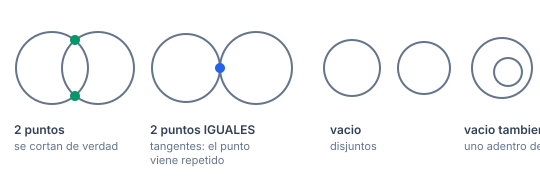
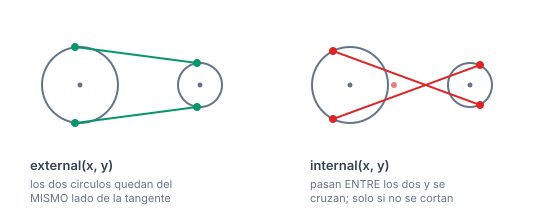
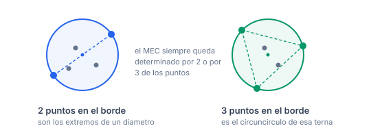

# Circles

Círculos: contención, intersección, tangentes, circuncentro y círculo mínimo envolvente.

## Índice

- [Cómo se arma la submission](#cómo-se-arma-la-submission)
- [El contrato de tipos](#el-contrato-de-tipos)
- [`Circle.h`](#circleh)
  - [`in`](#in)
  - [`arcLength`](#arclength)
- [`CircleIsect.h`](#circleisecth)
  - [`isect(Circ, Circ)`](#isectcirc-circ)
  - [`isect(Circ, Line)`](#isectcirc-line)
  - [`isect_area`](#isect_area)
- [`CircleTangents.h`](#circletangentsh)
  - [`tangent`](#tangent)
  - [`external`](#external)
  - [`internal`](#internal)
- [`Circumcenter.h`](#circumcenterh)
  - [`ccCenter`](#cccenter)
- [`MinEnclosingCirc.h`](#minenclosingcirch)
  - [`mec`](#mec)
- [Casos de uso recurrentes, de punta a punta](#casos-de-uso-recurrentes-de-punta-a-punta)
  - [¿Se cortan estos dos círculos?](#se-cortan-estos-dos-círculos)
  - [Tangente, y de qué tipo](#tangente-y-de-qué-tipo)
  - [Área de la unión de dos círculos](#área-de-la-unión-de-dos-círculos)
  - [Recortar un segmento contra un círculo](#recortar-un-segmento-contra-un-círculo)
  - [El círculo que pasa por tres puntos](#el-círculo-que-pasa-por-tres-puntos)
  - [¿Un disco de radio r puede cubrir todos los puntos?](#un-disco-de-radio-r-puede-cubrir-todos-los-puntos)
  - [Camino más corto entre dos puntos rodeando un obstáculo circular](#camino-más-corto-entre-dos-puntos-rodeando-un-obstáculo-circular)
- [Verificación](#verificación)

## Cómo se arma la submission

Copiás `templateHeavy.cpp` en `E.cpp` y pegás el **código** de los headers que necesites en la sección de template.

> **Los `#include` no van en la solución.** Ningún header de esta librería tiene `#include`. El campo `Requiere:` del encabezado es solo un **indicador** de qué otros templates hay que pegar también, y en qué orden.

Acá el orden importa más que en el resto, porque hay una cadena de dependencias:

| si pegás | pegá antes |
|---|---|
| `Circle.h` | `Point.h` |
| `CircleIsect.h` | `Point.h`, `Circle.h` |
| `CircleTangents.h` | `Point.h`, `Circle.h` |
| `Circumcenter.h` | `Point.h`, `Circle.h` |
| `MinEnclosingCirc.h` | `Point.h`, `Circle.h`, `Circumcenter.h` |

O sea: `Point.h` → `Circle.h` → lo que necesites. Y si vas a usar `mec`, la cadena completa es `Point.h` → `Circle.h` → `Circumcenter.h` → `MinEnclosingCirc.h`.

Cada uno va **una sola vez** por submission.

## El contrato de tipos

```cpp
using Circ = pair<P,T>;    // {centro, radio}
```

`x.f` es el centro (un `P`), `x.s` el radio (un `T`). Casi todas las funciones asumen **radio $\ge 0$**; la única excepción es `internal`, que usa un radio negativo como truco interno.

> Esta sección necesita raíces, `acos` y `atan2`, así que **dejá `T = db`**. Con `T = ll` los radios y las longitudes de arco truncan y los resultados no sirven.

---

## `Circle.h`

### `in`

```cpp
int in(const Circ& x, const P& y);
```

Dice dónde cae el punto `y` respecto del círculo `x`.

| valor | significado |
|---|---|
| `-1` | **adentro** |
| `0` | sobre el **borde** |
| `1` | **afuera** |

- Complejidad: $O(1)$.
- Usa `sgn`, o sea tolera `EPS`: un punto a $10^{-12}$ del borde cuenta como "sobre el borde".
- Casos de uso: verificar que una solución candidata cubre todos los puntos (es lo que valida `mec`); contar puntos dentro de un radio dado; filtrar antes de un cálculo más caro.

### `arcLength`

```cpp
T arcLength(const Circ& x, P a, P b);
```

La longitud del **arco menor** entre `a` y `b` sobre el círculo `x`.

- Complejidad: $O(1)$.
- **Precondición: `a` y `b` están sobre `x`.** La función no lo verifica.
- Devuelve siempre el arco **menor** (el ángulo sale de `acos`, que vive en $[0,\pi]$). Para el mayor: $2\pi r - \text{arcLength}$.
- Tiene un *clamp* a $[-1,1]$ antes del `acos`, para que el redondeo no produzca `NaN` cuando el coseno queda apenas por encima de 1.
- Casos de uso: perímetro de una figura con bordes curvos; distancia recorrida sobre una pista circular; sumar arcos al calcular el perímetro de una unión de círculos.

Implementación: `(a-c)/(b-c)` es la división de complejos, cuyo argumento es el ángulo $acb$. Como los dos puntos están en el círculo, el módulo de esa razón es 1 y su parte real **es** el coseno del ángulo central.

---

## `CircleIsect.h`

**Requiere:** `Point.h`, `Circle.h`

### `isect(Circ, Circ)`

```cpp
vP isect(const Circ& x, const Circ& y);
```

Los puntos donde se cortan dos círculos.



| resultado | significado |
|---|---|
| vacío | no se cortan (disjuntos, o uno contenido en el otro) |
| 2 puntos | se cortan en dos puntos |
| 2 puntos **iguales** | son **tangentes**: el punto de tangencia viene repetido |

- Complejidad: $O(1)$.
- **Precondición: `x != y`.** Con círculos concéntricos y mismo radio hay infinitas soluciones, y un `assert` lo corta.
- Caso especial manejado: si `x` tiene **radio 0** devuelve ese punto repetido si cae sobre `y`, o vacío si no. Sin esa rama se dividía por el radio y salían `(nan, nan)` disfrazados de dos puntos válidos.
- Casos de uso: trilateración (ubicar un punto a partir de distancias a dos referencias); construir el tercer vértice de un triángulo dados dos lados; intersección de regiones circulares.

> La tangencia viene **duplicada** a propósito, para que el tamaño del vector sea siempre 0 o 2 y no haya que ramificar. Si necesitás distinguirla: `sgn(abs(r[0]-r[1])) == 0`.

### `isect(Circ, Line)`

```cpp
vP isect(const Circ& x, const Line& y);
```

Los puntos donde la **recta infinita** `y` corta al círculo `x`.

| resultado | significado |
|---|---|
| vacío | la recta no toca el círculo |
| 2 puntos | la corta en dos puntos |
| 2 puntos iguales | **tangente** |

- Complejidad: $O(1)$.
- **Precondición: `y.f != y.s`** (usa `unit(y.s-y.f)`).
- Es una **recta**, no un segmento. Si necesitás los cortes con el segmento, filtrá después con `onSeg`.
- Implementación: proyecta el centro sobre la recta con `foot`, y a partir de ahí se mueve $\pm\sqrt{r^2 - d^2}$ en la dirección de la recta.
- Casos de uso: ¿la trayectoria recta pasa por la zona de alcance?; recortar un segmento contra un círculo; calcular la cuerda que una recta determina.

### `isect_area`

```cpp
T isect_area(Circ x, Circ y);
```

El **área** de la intersección (la lente) de dos círculos.

- Complejidad: $O(1)$.
- Casos manejados por separado, en este orden: disjuntos o tangentes por fuera ($d \ge a+b$) devuelve 0; uno contenido en el otro ($d \le a-b$) devuelve el área del chico — eso cubre también el caso radio 0.
- Los `acos` tienen *clamp* y el radicando de Herón tiene piso en 0, así que no produce `NaN`.
- Casos de uso: área cubierta por dos sensores circulares; probabilidad geométrica; integrar el área de una unión por inclusión-exclusión cuando hay pocos círculos.

> El header original decía *"not thoroughly tested"*. Lo verifiqué: tangente externa, tangente interna, círculos idénticos y $d$ casi igual a $a+b$ dan todos el valor exacto. La nota ya no está.

---

## `CircleTangents.h`

**Requiere:** `Point.h`, `Circle.h`

### `tangent`

```cpp
P tangent(P x, Circ y, int t = 0);
```

El punto de tangencia sobre el círculo `y` de una de las dos rectas tangentes trazadas desde el punto `x`. `t` elige cuál (`0` o `1`).

- Complejidad: $O(1)$.
- **Precondición: `x` está afuera o sobre `y`.** Desde adentro no hay tangentes.
- Si el radio es 0 devuelve el centro.
- Casos de uso: el ángulo visual con que se ve un círculo desde un punto; el camino más corto que rodea un obstáculo circular (recta + arco + recta); problemas de visibilidad.

> Toma `abs(y.s)` porque `internal` lo llama con radio negativo.

### `external`

```cpp
V<pair<P,P>> external(Circ x, Circ y);
```

Las **dos tangentes externas** a los círculos `x` e `y`: las que dejan los dos círculos del mismo lado. Devuelve dos pares `{punto sobre x, punto sobre y}`.



- Complejidad: $O(1)$.
- **Precondición: ninguno de los dos contiene estrictamente al otro** ($d > |r_x - r_y|$).
- Dos ramas: con radios **iguales** las tangentes son paralelas y se construyen con una normal; con radios distintos pasan por el **centro de homotecia externa**.
- Casos de uso: la correa que envuelve dos poleas; el casco convexo de un conjunto de círculos; el camino más corto entre dos círculos que los rodea.

> La separación de ramas usa `sgn(x.s - y.s)` y no `==`, y eso **no es cosmético**: con radios casi iguales el denominador del centro de homotecia es diminuto y ese centro se va al infinito.

### `internal`

```cpp
V<pair<P,P>> internal(Circ x, Circ y);
```

Las **dos tangentes internas**: las que pasan entre los dos círculos, cruzándose.

- Complejidad: $O(1)$.
- **Precondición: los círculos no se cortan** ($d > r_x + r_y$). Si se cortan, no existen.
- Implementación: una línea — `external({x.f, -x.s}, y)`. Negar el radio invierte el lado de tangencia, y las externas de ese círculo "reflejado" son las internas del original.
- Casos de uso: la correa cruzada entre dos poleas (que giran en sentidos opuestos); separar dos regiones circulares con una recta.

**Verificación:** 230.000 casos comprobando que los dos puntos de contacto caen sobre su círculo y que la recta que los une es tangente a los dos (`lineDist(centro, recta) == radio`). 0 fallas, con coordenadas hasta $10^5$.

---

## `Circumcenter.h`

**Requiere:** `Point.h`, `Circle.h`

### `ccCenter`

```cpp
Circ ccCenter(P a, P b, P c);
```

El **circuncentro** y el **circunradio** del triángulo `abc`: el único círculo que pasa por los tres puntos.

- Complejidad: $O(1)$.
- **Precondición: los tres puntos no son colineales y no hay dos iguales.** Un `assert` lo verifica.
- El circuncentro es la intersección de las tres mediatrices; equidista de los tres vértices.
- Casos de uso: lo usa `mec` para el caso de tres puntos en el borde; el centro del círculo que pasa por tres puntos dados; Delaunay y diagramas de Voronoi.

> Antes devolvía `(nan, nan)` en silencio con entrada degenerada, porque el denominador se anula. Ahora revienta con un `assert` que dice dónde. **Consecuencia del cambio:** si enumerás ternas arbitrarias (por ejemplo en una fuerza bruta), filtrá las colineales antes:
>
> ```cpp
> if (sgn(cross(a,b,c)) == 0) continue;   // antes de llamar a ccCenter
> ```

---

## `MinEnclosingCirc.h`

**Requiere:** `Point.h`, `Circle.h`, `Circumcenter.h`

### `mec`

```cpp
Circ mec(vP ps);
```

El **círculo mínimo que contiene a todos los puntos** (*minimum enclosing circle*, o círculo de Welzl).



La clave que hace funcionar el algoritmo: el círculo óptimo siempre queda **determinado por 2 o por 3 puntos** del conjunto. Por eso los tres bucles anidados alcanzan — van fijando esos puntos del borde, y la mezcla al azar es lo que hace que casi nunca haya que rehacerlos.

- Complejidad: $O(n)$ **esperado**. El algoritmo mezcla la entrada al azar y los tres bucles anidados se ejecutan, en promedio, un número constante de veces cada uno.
- Toma `ps` por copia, porque la mezcla.
- Funciona con entrada degenerada: un solo punto (devuelve radio 0), todos iguales, todos colineales. Verificado.
- Casos de uso: la antena de radio mínimo que cubre todas las casas; el problema clásico *Enclose All* (AtCoder ABC 151 F); cota inferior para "cubrir con un disco".

> **Ojo con el `rng` de semilla fija.** `templateHeavy.cpp` define `mt19937 rng(0)`, así que la mezcla es **determinista**. La complejidad esperada vale para una permutación al azar; con semilla fija, en teoría un test adversario podría forzar el peor caso. Si te preocupa, descomentá la línea de `rng` con semilla por tiempo:
>
> ```cpp
> mt19937 rng((uint32_t)chrono::steady_clock::now().time_since_epoch().count());
> ```

> El `holgura = 1+1e-8` es una tolerancia **multiplicativa**, distinta del `EPS` aditivo global. Antes se llamaba `EPS` y tapaba al global (`-Wshadow` lo marcaba).

**Verificación:** 5.900 casos contra fuerza bruta que prueba **todo par y toda terna** como círculo candidato, en grillas muy degeneradas ($C=2$, $C=3$) y dispersas ($C=10^6$). 0 diferencias. Además 14.000 casos confirmando que el `assert` nuevo de `ccCenter` nunca se dispara desde `mec`.

---

## Casos de uso recurrentes, de punta a punta

### ¿Se cortan estos dos círculos?

```cpp
T d = abs(x.f - y.f);
int rel = sgn(d - (x.s + y.s));          // >0 disjuntos, 0 tangentes por fuera
int con = sgn(d - abs(x.s - y.s));       // <0 uno contiene al otro
```

### Tangente, y de qué tipo

```cpp
auto r = isect(x, y);
if (sz(r) && sgn(abs(r[0]-r[1])) == 0) { /* tangentes */ }
```

### Área de la unión de dos círculos

```cpp
T total = PI*sq(x.s) + PI*sq(y.s) - isect_area(x, y);
```

### Recortar un segmento contra un círculo

```cpp
auto r = isect(c, l);                     // corta con la RECTA
vP dentro;
each(p, r) if (onSeg(p, l)) dentro.pb(p); // y despues filtra al segmento
```

### El círculo que pasa por tres puntos

```cpp
if (sgn(cross(a,b,c)) != 0) {
    auto cc = ccCenter(a, b, c);
    // cc.f es el centro, cc.s el radio
}
```

### ¿Un disco de radio r puede cubrir todos los puntos?

```cpp
bool alcanza = sgn(mec(ps).s - r) <= 0;
```

### Camino más corto entre dos puntos rodeando un obstáculo circular

```cpp
// si el segmento ab no toca el circulo, es la recta
if (sgn(segDist(c.f, Line{a,b}) - c.s) >= 0) ans = abs(b - a);
else {
    P ta = tangent(a, c, 0), tb = tangent(b, c, 1);
    ans = abs(ta - a) + arcLength(c, ta, tb) + abs(b - tb);
}
```

---

## Verificación

| rutina | casos | contra |
|---|---|---|
| `tangent`, `external`, `internal`, `ccCenter` | 230.000 | invariantes geométricas de contacto y tangencia |
| `mec` | 5.900 | fuerza bruta sobre todo par y toda terna |
| `ccCenter` (el `assert` no molesta a `mec`) | 14.000 | grillas degeneradas, $C$ de 1 a 10 |
| `isect(Circ,Circ)` con radio 0 | — | caso puntual: antes `(nan,nan)`, ahora el punto real |
| `isect_area` | — | tangente externa, interna, idénticos, $d \approx a+b$ |

`CircleTangents.h`, `Circumcenter.h` y `MinEnclosingCirc.h` **no compilaban** antes del commit `57c7c7f`: a `Point.h` le faltaban `operator*(T,P)` y los compuestos `+=` / `-=`. Quedaron verificados por primera vez.

Los cinco headers compilan con las flags del `Makefile` sin warnings.
