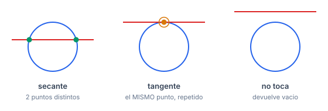

# Circles

Intersección, tangentes, circuncentro y círculo mínimo.

Manual de consulta: **qué hace cada método, qué le podés pasar y hasta dónde aguanta.** Los problemas donde practicar están en [PROBLEMS.md](../PROBLEMS.md).

## Índice

- [Cómo se arma la submission](#cómo-se-arma-la-submission)
- [Contrato de tipos](#contrato-de-tipos)
- [`Circle.h`](#circleh)
  - [`in`](#in)
  - [`arcLength`](#arclength)
- [`CircleIsect.h`](#circleisecth)
  - [`isect(Circ, Circ)`](#isectcirc-circ)
  - [`isect(Circ, Line)`](#isectcirc-line)
  - [`isect_area`](#isect_area)
- [`CircleTangents.h`](#circletangentsh)
  - [`tangent`](#tangent)
  - [`external`](#external)
  - [`internal`](#internal)
- [`Circumcenter.h`](#circumcenterh)
  - [`ccCenter`](#cccenter)
- [`MinEnclosingCirc.h`](#minenclosingcirch)
  - [`mec`](#mec)
- [Casos degenerados](#casos-degenerados)
- [Ejemplo completo](#ejemplo-completo)
- [Verificación](#verificación)

## Cómo se arma la submission

Copiás `templateHeavy.cpp` en `E.cpp` y pegás el **código** del header en la sección de template.

> **Los `#include` no van en la solución.** El campo `Requiere:` es solo un indicador de qué más pegar, y en qué orden.

| si pegás | pegá antes |
|---|---|
| `Circle.h` | `Point.h` |
| `CircleIsect.h` | `Point.h`, `Circle.h` |
| `CircleTangents.h` | `Point.h`, `Circle.h` |
| `Circumcenter.h` | `Point.h`, `Circle.h` |
| `MinEnclosingCirc.h` | `Point.h`, `Circle.h`, **`Circumcenter.h`** |

## Contrato de tipos

```cpp
using Circ = pair<P,T>;   // {centro, radio}
```

> **Toda esta carpeta exige `T = db`.** Usa `sqrt`, `acos`, `unit` y `dir`; con `T = ll` todo eso trunca a cero y los resultados salen mal **en silencio**, sin warning ni assert.

---

## `Circle.h`

**Requiere:** `Point.h`

### `in`

```cpp
int in(const Circ& x, const P& y);
```

Dónde cae `y` respecto de `x`: **`-1` adentro, `0` en el borde, `1` afuera**.

**Restricciones**: ninguna; radio 0 es válido · **Tipo**: `db` · **Complejidad**: $O(1)$.

```cpp
in({{0,0},2}, {1,0})  ->  -1     // adentro
in({{0,0},2}, {2,0})  ->   0     // borde (con EPS)
in({{0,0},0}, {0,0})  ->   0     // radio 0: su centro esta "en el borde"
```

### `arcLength`

```cpp
T arcLength(const Circ& x, P a, P b);
```

Longitud del arco **más corto** entre `a` y `b` sobre `x`.

> **No es el arco orientado.** El resultado siempre está en $[0, \pi r]$ y **no depende del orden** de `a` y `b`. Si necesitás el arco antihorario (que puede pasar de $\pi r$), tenés que calcularlo aparte.

**Restricciones**: `a` y `b` **deben estar sobre el círculo** — no se verifica · **Tipo**: `db` · **Complejidad**: $O(1)$.

```cpp
// circulo unidad en el origen
arcLength(c, {1,0},  {0,1})  ->  1.5708   // pi/2
arcLength(c, {0,1},  {1,0})  ->  1.5708   // el MISMO: no mira el sentido
arcLength(c, {1,0},  {1,0})  ->  0.0000
arcLength(c, {1,0}, {-1,0})  ->  3.1416   // pi, el maximo posible
```

El `acos` está *clampeado* a $[-1, 1]$: sin eso, un redondeo que deje el argumento en 1.0000000001 daría `nan`.

---

## `CircleIsect.h`

**Requiere:** `Point.h`, `Circle.h`

### `isect(Circ, Circ)`

```cpp
vP isect(const Circ& x, const Circ& y);
```

Los puntos de corte de dos círculos. **Una tangencia devuelve el mismo punto dos veces**, no uno.


**Restricciones**: **`x != y`** — con dos círculos idénticos hay infinitos puntos y salta un `assert` · **Tipo**: `db` · **Complejidad**: $O(1)$.

```cpp
isect({{0,0},2}, {{2,0},2})  ->  {(1,1.7321), (1,-1.7321)}   // secantes: 2 puntos
isect({{0,0},1}, {{2,0},1})  ->  {(1,0), (1,0)}              // tangentes: repetido
isect({{0,0},1}, {{9,0},1})  ->  {}                          // disjuntos
isect({{0,0},1}, {{0,0},2})  ->  {}                          // concentricos
isect({{1,0},0}, {{0,0},1})  ->  {(1,0), (1,0)}              // radio 0 sobre el borde
isect({{9,0},0}, {{0,0},1})  ->  {}                          // radio 0 afuera
```

> El caso de **radio 0** tiene una rama propia. Sin ella se dividía por el radio y salían `nan` en silencio.

### `isect(Circ, Line)`

```cpp
vP isect(const Circ& x, const Line& y);
```

Corte de un círculo con una **recta infinita** (no un segmento). Tangente → el mismo punto dos veces.



**Restricciones**: `y.f != y.s` · **Tipo**: `db` · **Complejidad**: $O(1)$.

```cpp
isect({{0,0},1}, {{-5,0},{5,0}})  ->  {(1,0), (-1,0)}   // secante
isect({{0,0},1}, {{-5,1},{5,1}})  ->  {(0,1), (0,1)}    // tangente: repetido
isect({{0,0},1}, {{-5,9},{5,9}})  ->  {}                // no toca
```

Para recortar un **segmento** hay que filtrar después con `onSeg`.

### `isect_area`

```cpp
T isect_area(Circ x, Circ y);
```

**Área** de la intersección de dos discos.

**Restricciones**: ninguna; cubre contención, tangencia y radio 0 · **Tipo**: `db` · **Complejidad**: $O(1)$.

```cpp
isect_area({{0,0},1}, {{0,0},1})  ->  3.1416   // identicos: pi
isect_area({{0,0},3}, {{0,0},1})  ->  3.1416   // uno dentro: area del chico
isect_area({{0,0},1}, {{2,0},1})  ->  0.0000   // tangentes
isect_area({{0,0},1}, {{9,0},1})  ->  0.0000   // disjuntos
isect_area({{0,0},1}, {{1,0},1})  ->  1.2284   // secantes
```

A diferencia de `isect(Circ,Circ)`, **este sí admite círculos idénticos**.

---

## `CircleTangents.h`

**Requiere:** `Point.h`, `Circle.h`

### `tangent`

```cpp
P tangent(P x, Circ y, int t = 0);
```

El punto donde la tangente desde `x` toca a `y`. `t = 0` y `t = 1` son los dos puntos posibles.

**Restricciones**: **`x` tiene que estar fuera del círculo o sobre el borde.** Con `x` adentro devuelve `(nan, nan)` **sin avisar** · **Tipo**: `db` · **Complejidad**: $O(1)$.

```cpp
tangent({3,0}, {{0,0},1}, 0)  ->  (0.3333,  0.9428)
tangent({3,0}, {{0,0},1}, 1)  ->  (0.3333, -0.9428)
tangent({0.5,0}, {{0,0},1})   ->  (nan, nan)     // punto ADENTRO
tangent({3,0}, {{0,0},0})     ->  (0, 0)         // radio 0: el centro
```

### `external`

```cpp
V<pair<P,P>> external(Circ x, Circ y);
```

Las **dos tangentes externas**: cada par es `{punto sobre x, punto sobre y}`.


**Restricciones**: **ningún círculo puede contener al otro.** Si uno contiene al otro devuelve **dos pares de `(nan, nan)`** — no devuelve vacío, y nada avisa · **Tipo**: `db` · **Complejidad**: $O(1)$.

```cpp
external({{0,0},1}, {{4,0},1})  ->  {(0,-1)->(4,-1), (0,1)->(4,1)}
external({{0,0},3}, {{0,0},1})  ->  {(nan,nan)->(nan,nan), (nan,nan)->(nan,nan)}
```

Con **radios iguales** usa una rama aparte (las tangentes son paralelas); si no, usa el centro de homotecia. El `sgn` de esa decisión no es cosmético: con radios casi iguales el centro se va al infinito.

### `internal`

```cpp
V<pair<P,P>> internal(Circ x, Circ y);
```

Las **dos tangentes internas**, las que cruzan entre los dos círculos. Es `external` con el radio de `x` negado.

**Restricciones**: los círculos **no pueden solaparse**; si se solapan, `(nan, nan)` · **Tipo**: `db` · **Complejidad**: $O(1)$.

```cpp
internal({{0,0},1}, {{4,0},1})  ->  {(0.5,0.866)->(3.5,-0.866), (0.5,-0.866)->(3.5,0.866)}
internal({{0,0},1}, {{2,0},1})  ->  {(1,0)->(1,0), (1,0)->(1,0)}   // tangentes internos
```

---

## `Circumcenter.h`

**Requiere:** `Point.h`, `Circle.h`

### `ccCenter`

```cpp
Circ ccCenter(P a, P b, P c);
```

`{circuncentro, circunradio}` del triángulo `abc`: el único círculo que pasa por los tres.

**Restricciones**: **los tres puntos no pueden ser colineales ni repetirse.** Un `assert` lo corta; sin él el resultado sería `nan` en silencio · **Tipo**: `db` · **Complejidad**: $O(1)$.

```cpp
ccCenter({0,0}, {4,0}, {0,4})  ->  centro (2, 2),      radio 2.8284
ccCenter({0,0}, {4,0}, {2,3})  ->  centro (2, 0.8333), radio 2.1667
```

> Si tu entrada puede traer ternas degeneradas, filtralas antes:
> ```cpp
> if (sgn(cross(a,b,c)) == 0) continue;
> ```

---

## `MinEnclosingCirc.h`

**Requiere:** `Point.h`, `Circle.h`, `Circumcenter.h`

### `mec`

```cpp
Circ mec(vP ps);
```

El **círculo mínimo que contiene todos los puntos** (Welzl).


**Restricciones**: $n \ge 1$; admite duplicados, todos iguales y todos colineales · **Tipo**: `db` · **Complejidad**: **$O(n)$ esperado — es un algoritmo aleatorizado.** El peor caso es $O(n^3)$, pero requiere un orden adversario; `mec` mezcla la entrada para evitarlo.

Toma `ps` **por copia**: la mezcla.

```cpp
mec({{3,3}})                      ->  centro (3,3),     radio 0
mec({{1,1},{1,1},{1,1}})          ->  radio 0
mec({{0,0},{1,1},{2,2},{3,3}})    ->  centro (1.5,1.5), radio 2.1213   // colineales
```

**Qué tan esperado es el $O(n)$.** Con 200 puntos al azar, contando cuántas veces entra cada bucle:

```
bucle i (reinicia el circulo) :  10 veces
bucle j (fija el 2do punto)   :  43 veces
bucle k (fija el 3ro)         :  30 veces
```

De 200 puntos, el bucle externo entró **10 veces**, no 200. Esa es la razón de que tres bucles anidados no sean cúbicos.

> **Ojo con el `rng` de semilla fija.** `templateHeavy.cpp` define `mt19937 rng(0)`, así que la mezcla es **determinista** y en teoría un test adversario podría forzar el peor caso. Si te preocupa:
> ```cpp
> mt19937 rng((uint32_t)chrono::steady_clock::now().time_since_epoch().count());
> ```

---

## Casos degenerados

Todas las salidas son de correr el código.

| situación | qué pasa |
|---|---|
| `isect` de dos círculos **idénticos** | **`assert`** |
| `isect` de **concéntricos** distinto radio | `{}` |
| `isect` **tangente** | el mismo punto **dos veces** |
| `isect` con **radio 0** | rama propia: el punto, o `{}` |
| `isect_area` de idénticos | área del círculo (no hay assert acá) |
| `tangent` con el punto **adentro** | **`(nan, nan)` en silencio** |
| `external` / `internal` con uno **dentro** del otro | **dos pares de `(nan, nan)` en silencio** |
| `ccCenter` con 3 **colineales** o repetidos | **`assert`** |
| `mec` de 1 punto | radio 0 |
| `mec` de todos iguales | radio 0 |
| `arcLength` con `a == b` | 0 |

> **El patrón a recordar:** `isect` y `ccCenter` **avisan** con un `assert`; las tangentes **no** — devuelven `nan` y siguen. Si tu entrada puede violar la precondición de `tangent`, `external` o `internal`, chequealo vos con `in()`.

## Ejemplo completo

Dos círculos, de la relación entre ellos al área común, con las salidas intermedias:

```cpp
Circ a = {{0,0}, 2}, b = {{3,0}, 2};

T d = abs(a.f - b.f);
cout << d << "\n";                       // 3        distancia entre centros
cout << sgn(d - (a.s + b.s)) << "\n";    // -1       d < r1+r2  => se cortan
cout << sgn(d - abs(a.s - b.s)) << "\n"; //  1       d > |r1-r2| => ninguno contiene al otro

auto p = isect(a, b);
cout << sz(p) << "\n";                   // 2
cout << p[0].f << "," << p[0].s << "\n"; // 1.5, 1.3229
cout << p[1].f << "," << p[1].s << "\n"; // 1.5, -1.3229

cout << isect_area(a, b) << "\n";        // 1.8132   area de la lente

// las tangentes externas son seguras porque ninguno contiene al otro
auto t = external(a, b);
cout << sz(t) << "\n";                   // 2 pares
// par 0: (0,-2) -> (3,-2)              radios iguales => tangentes paralelas

// PERO si uno contuviera al otro:
auto mal = external({{0,0},5}, {{0,0},1});
cout << mal[0].f.f << "\n";              // nan   <- sin aviso
```

Chequeo defensivo antes de llamar a las tangentes:

```cpp
bool seguro = sgn(abs(x.f - y.f) - abs(x.s - y.s)) > 0;   // ninguno contiene al otro
if (seguro) { auto t = external(x, y); /* ... */ }
```

## Verificación

| rutina | casos | contra |
|---|---|---|
| `tangent`, `external`, `internal`, `ccCenter` | 230.000 | invariantes geométricas de contacto y tangencia |
| `mec` | 5.900 | fuerza bruta sobre todo par y toda terna |
| `ccCenter` (el `assert` no molesta a `mec`) | 14.000 | grillas degeneradas, $C$ de 1 a 10 |
| `isect(Circ,Circ)` con radio 0 | — | caso puntual: antes `(nan,nan)`, ahora el punto real |
| `isect_area` | — | tangente externa, interna, idénticos, $d \approx a+b$ |

`CircleTangents.h`, `Circumcenter.h` y `MinEnclosingCirc.h` **no compilaban** antes del commit `57c7c7f`: a `Point.h` le faltaban `operator*(T,P)` y los compuestos `+=` / `-=`.

Los cinco compilan con las flags del `Makefile` sin warnings.
