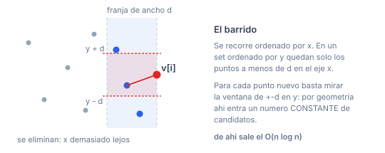
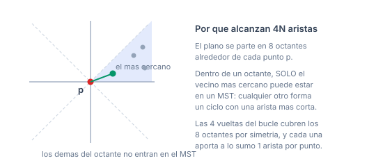

# Misc

Tres algoritmos sueltos que no entran en las otras categorías: par más cercano, MST con distancia Manhattan, y máxima cantidad de puntos colineales.

## Índice

- [Recursos](#recursos)
- [Cómo se arma la submission](#cómo-se-arma-la-submission)
- [Tres choques de nombres, todos verificados](#tres-choques-de-nombres-todos-verificados)
- [`ClosestPair.h`](#closestpairh)
  - [`solve`](#solve)
- [`ManhattanMST.h`](#manhattanmsth)
  - [`manhattanMst`](#manhattanmst)
- [`MaxCollinear.h`](#maxcollinearh)
  - [`getline`](#getline)
  - [`solve`](#solve-1)
- [Casos de uso recurrentes, de punta a punta](#casos-de-uso-recurrentes-de-punta-a-punta)
  - [Distancia mínima entre dos puntos del conjunto](#distancia-mínima-entre-dos-puntos-del-conjunto)
  - [¿Hay puntos repetidos?](#hay-puntos-repetidos)
  - [MST con distancia Manhattan](#mst-con-distancia-manhattan)
  - [MST con distancia Chebyshov (L infinito)](#mst-con-distancia-chebyshov-l-infinito)
  - [¿Están todos los puntos alineados?](#están-todos-los-puntos-alineados)
  - [Cuántas rectas distintas determinan los puntos](#cuántas-rectas-distintas-determinan-los-puntos)
- [Problemas](#problemas)
- [Verificación](#verificación)

## Recursos

| | |
|---|---|
| [cp-algorithms — Nearest points](https://cp-algorithms.com/geometry/nearest_points.html) | el barrido de `ClosestPair`, con la prueba de la cota de la franja |
| [cp-algorithms — Manhattan distance](https://cp-algorithms.com/geometry/manhattan-distance.html) | $L_1$, la rotación a $L_\infty$ y el MST Manhattan |
| [USACO Guide — Sweep Line](https://usaco.guide/plat/sweep-line) | los tres temas de esta carpeta, con problemas |

## Cómo se arma la submission

Copiás `templateHeavy.cpp` en `E.cpp` y pegás el **código** de los headers que necesites en la sección de template.

> **Los `#include` no van en la solución.** Ningún header de esta librería tiene `#include`. El campo `Requiere:` del encabezado es solo un **indicador** de qué otros templates hay que pegar también, y en qué orden.

**Los tipos de entrada son inconsistentes** entre los tres, y conviene saberlo antes de pelearse con el compilador:

| header | entrada | pegá antes |
|---|---|---|
| `ClosestPair.h` | `vP` = `vector<pair<T,T>>` | **`Point.h`** |
| `ManhattanMST.h` | `vpi` = `vector<pair<int,int>>` | — nada |
| `MaxCollinear.h` | `vpi` = `vector<pair<int,int>>` | — nada |

Los dos últimos trabajan con coordenadas **`int`** y son completamente independientes del resto de la librería: se pegan solos, sin `Point.h`.

## Tres choques de nombres, todos verificados

Esta carpeta tiene los peores nombres de la librería. Ninguno rompe nada, pero hay que saberlo:

| nombre | con qué choca | resultado |
|---|---|---|
| `solve` en `ClosestPair.h` | `solve` en `MaxCollinear.h` | **conviven** (sobrecarga: `vP` vs `vpi`) |
| `solve` en los dos | tu `void solve()` de `templateHeavy.cpp` | **conviven** (la tuya no toma argumentos) |
| `getline` en `MaxCollinear.h` | `std::getline` | **conviven** (`getline(cin, s)` sigue funcionando) |

Los tres los compilé y corrí. Pero si pegás `ClosestPair.h` y dentro de tu `solve()` escribís `solve(v)`, mirá bien a quién estás llamando.

---

## `ClosestPair.h`

**Requiere:** `Point.h` · $O(n \log n)$

> **Problema ancla:** [Kattis — Closest Pair](https://open.kattis.com/problems/closestpair2) *(Medium)*. Si nunca lo resolviste, intentalo antes de seguir leyendo.

### `solve`

```cpp
pair<P,P> solve(vP v);
```

Los **dos puntos más cercanos** del conjunto.

- Complejidad: $O(n \log n)$ — barrido de línea con un `set` ordenado por $y$.
- Toma `v` por copia, porque lo ordena.
- Si hay **puntos repetidos** devuelve ese punto dos veces (distancia 0) y corta de entrada.
- **Precondición: al menos 2 puntos.**
- Devuelve el par, no la distancia: `abs(r.f - r.s)` te la da.
- Casos de uso:
  - El problema clásico *closest pair* (Kattis `closestpair2`).
  - Detectar si dos elementos están a menos de $d$ (comparar contra la distancia mínima).
  - Verificar que todos los puntos de una entrada son distintos, con la distancia en 0 como señal.
  - Cota inferior para problemas de "separar puntos" o empaquetado.

**Cómo funciona:** ordena por $x$ y barre de izquierda a derecha, manteniendo en un `set` ordenado por $y$ solo los puntos que están a menos de la mejor distancia actual en el eje $x$. Para cada punto nuevo, solo mira la franja de $\pm d$ en $y$ — que por geometría contiene un número constante de candidatos.



Por qué la franja contiene pocos puntos: todos los que están adentro distan entre sí **al menos $d$** (si no, $d$ ya sería menor). En un rectángulo de $d \times 2d$ no entran más que un puñado de puntos separados por $d$, y esa cota constante es la que convierte el barrido en $O(n \log n)$.

**Verificación:** 5.500 casos contra fuerza bruta $O(n^2)$, incluyendo configuraciones con muchos duplicados y colineales ($C=4$ con hasta 9 puntos), medias y dispersas ($C=10^5$ con hasta 120 puntos). 0 diferencias.

---

## `ManhattanMST.h`

**Independiente** (no requiere `Point.h`) · $O(n \log n)$

> **Problema ancla:** [Kattis — Grid MST](https://open.kattis.com/problems/gridmst) *(Medium)*. Si nunca lo resolviste, intentalo antes de seguir leyendo.

### `manhattanMst`

```cpp
V<pair<ll,pi>> manhattanMst(vpi v);
```

Dados $n$ puntos, devuelve **hasta $4n$ aristas** que están garantizadas a contener un árbol de expansión mínimo del grafo completo con peso

$$w(p,q) = |p_x - q_x| + |p_y - q_y|$$

Las aristas vienen como `{distancia, {índice_origen, índice_destino}}`.

- Complejidad: $O(n \log n)$.
- **No devuelve el MST: devuelve los candidatos.** Después hay que correr un MST cualquiera sobre ellas:

```cpp
auto ed = manhattanMst(v);
sort(all(ed));
DSU D; D.init(sz(v)); ll total = 0;
each(e, ed) if (D.unite(e.s.f, e.s.s)) total += e.f;
```

- Las distancias van en `ll`. Con coordenadas de $10^9$ un `int` desborda: las diferencias llegan a $2 \cdot 10^9$ y las sumas a $4 \cdot 10^9$.
- Toma `v` por copia, porque lo transforma internamente (hace cuatro rotaciones/reflexiones del plano).
- Casos de uso:
  - MST con distancia Manhattan, que es el caso de uso directo (Kattis `gridmst`).
  - Conectar puntos en una grilla donde solo se puede ir en horizontal y vertical: cableado, cañerías, calles.
  - Cualquier problema que diga "unir todos los puntos al mínimo costo" con costo $L_1$.
  - También sirve para **distancia Chebyshov** ($L_\infty$): rotando el plano 45° ($x' = x+y$, $y' = x-y$), $L_\infty$ se convierte en $L_1$.

**Por qué $4n$ aristas alcanzan:** para cada punto, en cada uno de los 8 octantes, solo el **vecino más cercano** puede formar parte de un MST. Las cuatro vueltas del bucle cubren los 8 octantes por simetría, y cada vuelta aporta a lo sumo una arista por punto.



El argumento es el mismo que justifica cualquier algoritmo de MST geométrico: si dentro de un octante tomaras un vecino que **no** es el más cercano, esa arista cerraría un ciclo en el que alguna otra es más corta, y la propiedad del ciclo la deja afuera del MST. Así que basta con generar, por punto y por octante, una sola candidata: $8n$ en total, que por simetría se calculan en $4$ pasadas.

<details>
<summary><b>Ejemplo trazado: 5 puntos, de las candidatas al MST</b></summary>

Entrada: `0:(0,0)  1:(3,1)  2:(1,4)  3:(5,5)  4:(2,2)`.

El grafo completo tiene C(5,2) = 10 aristas. `manhattanMst` devuelve **9 candidatas** — la cota 4n sería 20, así que ni se acerca:

| peso | arista |
|---:|---|
| 2 | 1–4 |
| 2 | 1–4 *(repetida)* |
| 3 | 4–2 |
| 4 | 1–0 |
| 4 | 4–0 |
| 5 | 3–2 |
| 6 | 3–1 |
| 6 | 3–4 |
| 6 | 3–4 *(repetida)* |

**Las repetidas son normales:** las 4 pasadas cubren octantes distintos, pero un mismo par puede ser "el vecino más cercano" en más de uno. Kruskal las descarta solo, no hace falta deduplicar.

Lo interesante es **lo que falta**. De los 10 pares posibles solo aparecen 7: nunca se generan **0–2 (5)**, **0–3 (10)** ni **1–2 (5)**. Y los tres están descartados por la propiedad del ciclo — en cada caso la arista es el máximo **estricto** de un ciclo, así que ningún MST la puede usar:

| arista ausente | ciclo que la mata | pesos |
|---|---|---|
| 0–2 (5) | 0–4–2–0 | 4, 3, **5** |
| 0–3 (10) | 0–4–2–3–0 | 4, 3, 5, **10** |
| 1–2 (5) | 1–4–2–1 | 2, 3, **5** |

Eso es exactamente lo que garantiza el argumento de los octantes: las que no se generan son justamente las que nunca harían falta.

Kruskal sobre las 9:

| paso | arista | peso | por qué |
|---|---|---:|---|
| 1 | 1–4 | 2 | la más corta |
| 2 | 4–2 | 3 | conecta 2 |
| 3 | 1–0 | 4 | conecta 0 |
| 4 | 3–2 | 5 | conecta 3 |

**Peso del MST: 14.** Verificado contra el MST del grafo completo `O(n^2)`: mismo valor.

</details>

**Verificación:** 6.300 casos comparando el peso del MST sacado de las $\le 4n$ aristas contra el MST del grafo **completo** $O(n^2)$, con $C$ de 3 a $10^9$. 0 diferencias. Fue la primera vez que este header se verificó: antes **no compilaba** (incluía una ruta muerta, `"DSU (7.6).h"`).

---

## `MaxCollinear.h`

**Independiente** (no requiere `Point.h`) · $O(n^2 \log n)$

> **Problema ancla:** [Kattis — Max Collinear](https://open.kattis.com/problems/maxcolinear) *(Hard)*, o [LeetCode — Max Points on a Line](https://leetcode.com/problems/max-points-on-a-line/description/) *(Easy)* para la versión chica.

### `getline`

```cpp
pair<pi,ll> getline(pi a, pi b);
```

La **clave canónica** de la recta que pasa por `a` y `b`: `{dirección normal normalizada, desplazamiento}`. Dos pares de puntos de la **misma recta** producen la misma clave, y pares de rectas distintas producen claves distintas.

- Complejidad: $O(\log \max |c|)$ — lo domina el `gcd`.
- **Precondición: `a != b`.** Un `assert` lo verifica: con dos puntos iguales la dirección es $(0,0)$, `gcd(0,0)` da 0 y se dividiría por cero.
- La normalización tiene dos pasos: dividir por el `gcd` (para que la dirección sea primitiva) y fijar el signo con `ckmin` (para que una dirección y su opuesta den la misma clave).
- El desplazamiento va en **`ll`**: con dirección y coordenadas de $10^5$ el producto llega a $10^{10}$ y un `int` desborda.
- Caso de uso: agrupar pares de puntos por recta. Es la función interna de `solve`, pero suelta sirve para cualquier problema de "contar rectas distintas" o "agrupar puntos colineales".

> El nombre choca con `std::getline`. **No lo rompe** — conviven por sobrecarga y `getline(cin, s)` sigue leyendo bien, lo verifiqué. Pero es un nombre desafortunado.

### `solve`

```cpp
int solve(vpi p);
```

La **máxima cantidad de puntos que caen sobre una misma recta**.

- Complejidad: $O(n^2 \log n)$. Son $\binom{n}{2}$ claves y un `map`.
- **Límite práctico: $n \approx 2000$.** Con $n = 2000$ son 2 millones de inserciones en un `map`; con $n = 10^5$ es inviable.
- **Precondición: no hay dos puntos iguales.** El `assert` de `getline` lo corta.
- Con un solo punto devuelve 1; con cero puntos devuelve 0.
- Casos de uso:
  - El problema clásico *max collinear points* (Kattis `maxcolinear`).
  - "¿Cuántos puntos puedo alinear?" / "¿con cuántas rectas cubro todos los puntos?" (cota inferior).
  - Detectar si todos los puntos son colineales: `solve(p) == sz(p)`.

**Cómo funciona:** cuenta, para cada recta, cuántos **pares** de puntos la determinan. Una recta con $k$ puntos aporta exactamente $\binom{k}{2}$ pares, así que al final invierte esa relación: busca el mayor $k$ con $\binom{k}{2} \le \text{máximo}$.

> **Un detalle de robustez que conviene conocer.** Aunque el desplazamiento ahora va en `ll`, el esquema sigue siendo "agrupar por clave": si dos rectas distintas produjeran la misma clave, el conteo saldría mal. Con `ll` eso requeriría coordenadas absurdamente grandes, y 6.000 casos aleatorios hasta $10^9$ no encontraron ninguna colisión. Pero si necesitás garantía total con $n$ grande, el enfoque alternativo —para cada punto, ordenar las direcciones a los demás y contar el grupo más largo— es igual de $O(n^2 \log n)$, maneja duplicados de forma natural y no depende de ninguna clave.

**Verificación:** 6.000 casos contra fuerza bruta exacta en `__int128`, con $C$ de 6 a $10^9$. 0 diferencias.

---

## Casos de uso recurrentes, de punta a punta

### Distancia mínima entre dos puntos del conjunto

```cpp
auto r = solve(v);                  // ClosestPair
db d = (db)abs(r.f - r.s);
```

### ¿Hay puntos repetidos?

```cpp
auto r = solve(v);
bool repetidos = sgn(abs(r.f - r.s)) == 0;
```

### MST con distancia Manhattan

```cpp
auto ed = manhattanMst(v);
sort(all(ed));
DSU D; D.init(sz(v)); ll total = 0; int usadas = 0;
each(e, ed) if (D.unite(e.s.f, e.s.s)) { total += e.f; ++usadas; }
// usadas == sz(v)-1 si el grafo quedo conexo
```

### MST con distancia Chebyshov (L infinito)

```cpp
vpi w; each(p, v) w.pb({p.f + p.s, p.f - p.s});   // rota 45 grados
auto ed = manhattanMst(w);                        // L_inf pasa a ser L_1
// cada peso resultante es el DOBLE de la distancia Chebyshov
```

### ¿Están todos los puntos alineados?

```cpp
bool todos = (solve(p) == sz(p));   // MaxCollinear, sin puntos repetidos
```

### Cuántas rectas distintas determinan los puntos

```cpp
set<pair<pi,ll>> rectas;
F0R(i, sz(p)) FOR(j, i+1, sz(p)) rectas.ins(getline(p[i], p[j]));
int cuantas = sz(rectas);
```

---

## Problemas

| fuente | problema | dificultad | con qué |
|---|---|---|---|
| Kattis | [Closest Pair](https://open.kattis.com/problems/closestpair2) | Medium | `ClosestPair.h` |
| Kattis | [Grid MST](https://open.kattis.com/problems/gridmst) | Medium | `ManhattanMST.h` + Kruskal |
| LeetCode | [Max Points on a Line](https://leetcode.com/problems/max-points-on-a-line/description/) | Easy | `MaxCollinear.h` |
| Kattis | [Max Collinear](https://open.kattis.com/problems/maxcolinear) | Hard | `MaxCollinear.h` |
| AtCoder | [Manhattan Multifocal Ellipse](https://atcoder.jp/contests/abc366/tasks/abc366_e) | Hard | $L_1$, sin MST |
| CS Academy | [The Sprawl](https://csacademy.com/contest/archive/task/the-sprawl) | Hard | MST Manhattan |

Lista tomada de [USACO Guide — Sweep Line](https://usaco.guide/plat/sweep-line) y [Geometry Primitives](https://usaco.guide/plat/geo-pri).

---

## Verificación

| rutina | casos | contra |
|---|---|---|
| `manhattanMst` | 6.300 | MST del grafo completo $O(n^2)$, $C$ hasta $10^9$ |
| `getline`, `solve` (MaxCollinear) | 6.000 | fuerza bruta en `__int128`, $C$ hasta $10^9$ |
| `solve` (ClosestPair) | 5.500 | fuerza bruta $O(n^2)$, con duplicados y colineales |

Los tres headers compilan con las flags del `Makefile` sin warnings.

`ManhattanMST.h` **no compilaba** antes del commit `57c7c7f` (incluía `"DSU (7.6).h"`, una ruta que no existe en este repo), y `MaxCollinear.h` **crasheaba** con puntos duplicados y desbordaba su clave con coordenadas de $10^5$.
