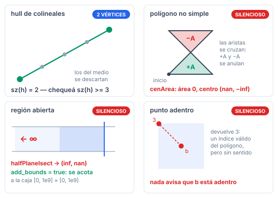

# Polygons

Convex hull, área, punto en polígono, tangentes, Minkowski, semiplanos.

Manual de consulta: **qué hace cada método, qué le podés pasar y hasta dónde aguanta.** Los problemas donde practicar están en [PROBLEMS.md](../PROBLEMS.md).

## Índice

- [Cómo se arma la submission](#cómo-se-arma-la-submission)
- [Dos convenciones](#dos-convenciones)
- [`ConvexHull.h`](#convexhullh)
  - [`ulHull`](#ulhull)
  - [`hullInd`](#hullind)
  - [`hull`](#hull)
- [`ConvexHullGraham.h`](#convexhullgrahamh)
- [`PolygonCenArea.h`](#polygoncenareah)
  - [`cenArea`](#cenarea)
- [`InPolygon.h`](#inpolygonh)
  - [`inPoly`](#inpoly)
- [`HullDiameter.h`](#hulldiameterh)
  - [`diameter2`](#diameter2)
- [`HullTangents.h`](#hulltangentsh)
  - [`lower`, `better`](#lower-better)
  - [`tangent`](#tangent)
- [`MinkowskiSum.h`](#minkowskisumh)
  - [`minkowski_sum`](#minkowski_sum)
- [`LineHull.h`](#linehullh)
  - [`extrVertex`](#extrvertex)
  - [`lineHull`](#linehull)
- [`HalfPlaneIsect.h`](#halfplaneisecth)
  - [`Ray`](#ray)
  - [`halfPlaneIsect`](#halfplaneisect)
- [Casos degenerados](#casos-degenerados)
- [Ejemplo completo](#ejemplo-completo)
- [Verificación](#verificación)
- [Lo que no está](#lo-que-no-está)

## Cómo se arma la submission

Copiás `templateHeavy.cpp` en `E.cpp` y pegás el **código** del header en la sección de template.

> **Los `#include` no van en la solución.** El campo `Requiere:` es solo un indicador de qué más pegar, y en qué orden.

| si pegás | pegá antes |
|---|---|
| `ConvexHull.h` *(o `ConvexHullGraham.h`)* | `Point.h` |
| `PolygonCenArea.h`, `InPolygon.h`, `HullTangents.h`, `MinkowskiSum.h`, `LineHull.h` | `Point.h` |
| `HalfPlaneIsect.h` | `Point.h`, **`AngleCmp.h`** |
| `HullDiameter.h` | `Point.h`, **un hull** (llama a `hull()`) |

> **`ConvexHull.h` y `ConvexHullGraham.h` son alternativas, no complementos.** Los dos definen `hullInd` y `hull`; pegar ambos da `redefinition of 'vi hullInd(const vP&)'`. **Usá `ConvexHull.h`.**

## Dos convenciones

**1. El hull es ESTRICTO.** Descarta los puntos colineales del borde: de tres puntos alineados sobre una arista, solo quedan los dos extremos.


**2. `hull` es exacto, `inPoly` usa `EPS`.** El `cross` del hull va crudo, sin `sgn` — está pensado para coordenadas enteras. `inPoly` detecta el borde con `onSeg`, que sí pasa por `sgn`.

---

## `ConvexHull.h`

**Requiere:** `Point.h`

### `ulHull`

```cpp
pair<vi,vi> ulHull(const vP& v);
```

Las dos cadenas del hull como **índices**: `.f` la de **arriba**, `.s` la de **abajo**. Las dos van de izquierda a derecha y comparten los puntos extremos.


**Restricciones**: ninguna; admite repetidos y colineales · **Tipo**: `ll` recomendado (el `cross` es exacto, sin `EPS`) · **Aguanta**: igual que `cross(p,a,b)`: con `ll` hasta $C \approx 1{,}5 \cdot 10^9$, con `long double` hasta $\approx 2{,}1 \cdot 10^9$ · **Complejidad**: $O(n \log n)$, domina el sort.

Sirve suelta para el **Convex Hull Trick** geométrico, o para recorrer solo "el techo" de una nube.

### `hullInd`

```cpp
vi hullInd(const vP& v);
```

Los **índices** de los vértices del hull, en orden **antihorario (CCW)**.

**Restricciones**: ninguna · **Tipo**: igual que `ulHull` · **Aguanta**: igual que `ulHull` · **Complejidad**: $O(n \log n)$.

```cpp
hullInd({{0,0},{1,1},{2,2},{3,3}})  ->  {0,3}     // colineales: los 2 extremos
```

Usala cuando necesites saber **qué puntos originales** quedaron, no solo sus coordenadas.

### `hull`

```cpp
vP hull(const vP& v);
```

Los **vértices** del hull en orden **antihorario (CCW)**.

**Restricciones**: ninguna · **Tipo**: igual que `ulHull` · **Aguanta**: igual que `ulHull` · **Complejidad**: $O(n \log n)$.

```cpp
hull({{0,0}})                        ->  {(0,0)}                    // 1 punto
hull({{0,0},{1,1}})                  ->  {(0,0), (1,1)}             // 2 puntos
hull({{2,2},{2,2},{2,2}})            ->  {(2,2)}                    // todos iguales
hull({{0,0},{1,1},{2,2},{3,3}})      ->  {(0,0), (3,3)}             // colineales
hull(100 puntos colineales)          ->  {(0,0), (99,0)}            // 2, no 100
hull({{0,0},{2,0},{4,0},{0,4}})      ->  {(0,0), (4,0), (0,4)}      // ESTRICTO: (2,0) afuera
```

> **El hull puede salir con menos de 3 vértices.** Si tu código asume un polígono, chequeá `sz(h) >= 3` antes.

---

## `ConvexHullGraham.h`

```cpp
vi hullInd(const vP& v);
vP hull(const vP& v);
```

Lo mismo por **Graham scan**: ordena por ángulo alrededor del punto más bajo en vez de por coordenada. Misma salida, misma complejidad, verificado contra la misma referencia.

| | `ConvexHull.h` | `ConvexHullGraham.h` |
|---|---|---|
| algoritmo | cadena monótona (Andrew) | Graham scan |
| extra | expone `ulHull` | — |
| líneas | 34 | 27 |

**Usá `ConvexHull.h`** salvo que tengas una razón concreta.

---

## `PolygonCenArea.h`

**Requiere:** `Point.h`

### `cenArea`

```cpp
pair<P,T> cenArea(const vP& v);
```

`{centroide, área con signo}` de un polígono **simple**. El signo es **positivo si viene en CCW**, negativo si en CW.


Para el área a secas: `abs(cenArea(v).s)`.

**Restricciones**: **$n \ge 3$** (`assert`); el polígono tiene que ser **simple** — sin aristas que se crucen. Con uno no simple devuelve basura sin avisar · **Tipo**: con `T = ll` **las dos divisiones truncan**, la del centroide y la del área (el acumulador interno vale $2A$ y se devuelve `/2`): con enteros acumulá el doble del área a mano · **Aguanta**: con `ll`, el área es exacta hasta $C = 10^9$, pero **el centroide desborda en silencio desde $C \approx 1{,}4 \cdot 10^6$** (medido: bien a $1{,}4 \cdot 10^6$, basura a $2 \cdot 10^6$; su acumulador crece como $C^3$). Con `long double` no hay desborde · **Complejidad**: $O(n)$.

```cpp
cenArea({{0,0},{4,0},{4,4},{0,4}})   ->  centro (2,2), area =  16   // CCW
cenArea(el mismo invertido)          ->                area = -16   // CW

// polígono NO simple (un moño) — precondición rota:
cenArea({{0,0},{4,0},{0,4},{4,4}})   ->  area = 0, centro (nan,-inf)
```

> El signo es una forma barata de **detectar la orientación**: `sgn(cenArea(v).s) > 0` ⟺ CCW.

---

## `InPolygon.h`

**Requiere:** `Point.h`

### `inPoly`

```cpp
int inPoly(const P& p, const vP& poly);
```

Dónde cae `p`: **`-1` adentro, `0` sobre el borde, `1` afuera**. Por *ray casting*: cuenta cuántas veces un rayo cruza el borde.


**Restricciones**: el polígono tiene que ser **simple**, pero **no** hace falta que sea convexo ni que venga en un orden particular — **anda igual en CW y en CCW** · **Tipo**: `db` o `ll` · **Aguanta**: con `p` de entrada, igual que `cross`; si `p` es un punto **calculado**, el borde (`0`) se pierde desde $C \approx 10^5$ · **Complejidad**: $O(n)$ por consulta.

```cpp
// cuadrado (0,0)(4,0)(4,4)(0,4)
inPoly({2,2}, sq)  ->  -1    // adentro
inPoly({2,0}, sq)  ->   0    // sobre una arista
inPoly({0,0}, sq)  ->   0    // sobre un vertice
inPoly({9,9}, sq)  ->   1    // afuera
inPoly({2,2}, sq_invertido)  ->  -1    // el MISMO resultado en CW

// polígono en L (no convexo): (0,0)(4,0)(4,2)(2,2)(2,4)(0,4)
inPoly({1,1}, L)   ->  -1    // adentro
inPoly({3,3}, L)   ->   1    // en la muesca: afuera
inPoly({2,2}, L)   ->   0    // el vertice reflex
```

> Para un **convexo** con muchas consultas, $O(n)$ por consulta es caro. La versión $O(\log n)$ sale de `tangent` o de una binaria angular; no está hecha acá (Benq tampoco la tiene).

---

## `HullDiameter.h`

**Requiere:** `Point.h`, **un hull**

### `diameter2`

```cpp
T diameter2(vP ps);
```

El **cuadrado** de la mayor distancia entre dos puntos del conjunto, por *rotating calipers*.

> **No le pases el hull: pasale los puntos crudos.** Lo calcula internamente.
> **Devuelve el cuadrado**, no la distancia: `sqrt(diameter2(ps))`.

**Restricciones**: $n \ge 1$ · **Tipo**: `ll` conviene — el cuadrado queda exacto · **Aguanta**: el resultado llega a $8C^2$; con `ll` entra hasta $C \approx 1{,}07 \cdot 10^9$ (con $C = 10^9$: $8 \cdot 10^{18} < 9{,}2 \cdot 10^{18}$) · **Complejidad**: $O(n \log n)$ en total, $O(n)$ dado el hull.

```cpp
diameter2({{0,0}})              ->  0
diameter2({{0,0},{3,4}})        ->  25        // 5^2
diameter2({{1,1},{1,1},{1,1}})  ->  0
diameter2(100 colineales 0..99) ->  9801      // 99^2
```

---

## `HullTangents.h`

**Requiere:** `Point.h`

### `lower`, `better`

```cpp
bool lower;                      // variable GLOBAL
bool better(P a, P b, P c);
```

`lower` elige **cuál de las dos tangentes** busca `tangent`. Son internas, pero `lower` hay que setearla antes de cada llamada.

> **Es una variable global.** Si la olvidás, `tangent` devuelve la tangente que quedó de la llamada anterior.

### `tangent`

```cpp
int tangent(const vP& a, P b);
```

El **índice** del vértice donde la tangente desde `b` toca al convexo `a`.


**Restricciones**: `a` tiene que ser **convexo, en CCW y sin tres vértices colineales** — el hull estricto de `ConvexHull.h` cumple las tres. **`b` tiene que estar estrictamente afuera**: con `b` adentro devuelve un índice **plausible pero incorrecto**, sin avisar · **Tipo**: `db` o `ll` · **Aguanta**: igual que `cross(p,a,b)` · **Complejidad**: $O(\log n)$.

```cpp
// cuadrado CCW (0,0)(4,0)(4,4)(0,4), punto (10,2) afuera
lower = 1;  tangent(sq, {10,2})  ->  2
lower = 0;  tangent(sq, {10,2})  ->  1

lower = 1;  tangent(sq, {2,2})   ->  3    // punto ADENTRO: basura silenciosa
```

---

## `MinkowskiSum.h`

**Requiere:** `Point.h`

### `minkowski_sum`

```cpp
vP minkowski_sum(vP a, vP b);
```

La **suma de Minkowski** $\{p + q : p \in A,\ q \in B\}$ de dos convexos. El resultado es convexo y queda en CCW.


**Restricciones**: `a` y `b` tienen que ser **convexos y venir en CCW** — no se verifica; con otro orden el resultado es basura · **Tipo**: `db` o `ll` · **Aguanta**: las coordenadas se **suman**, así que el resultado llega a $2C$ · **Complejidad**: $O(n + m)$ — lineal, porque fusiona las aristas ya ordenadas por ángulo.

```cpp
minkowski_sum(sq, {{0,0},{2,0},{0,2}})  ->  {(0,0),(6,0),(6,4),(4,6),(0,6)}   // 5 vertices
minkowski_sum(sq, {{10,10}})            ->  {(10,10),(14,10),(14,14),(10,14)} // traslacion
minkowski_sum(sq, {})                   ->  {}
```

> **El uso clásico:** dos convexos $A$ y $B$ chocan ⟺ el origen está dentro de $A \oplus (-B)$.

---

## `LineHull.h`

**Requiere:** `Point.h`

### `extrVertex`

```cpp
int extrVertex(const vP& poly, P nrm);
```

El índice del vértice de **máxima proyección** sobre la dirección `nrm`.

> El parámetro se llama `nrm` y no `dir` porque `dir()` ya es una función de `Point.h`.

**Restricciones**: `poly` **convexo en CCW** · **Tipo**: cualquiera · **Aguanta**: cada término es `nrm` por una diferencia de vértices: con `ll`, hasta $4C \cdot \max|nrm|$ · **Complejidad**: $O(\log n)$.

```cpp
// cuadrado CCW (0,0)(4,0)(4,4)(0,4)
extrVertex(sq, {1,0})   ->  1     // (4,0)
extrVertex(sq, {0,1})   ->  2     // (4,4)
extrVertex(sq, {-1,0})  ->  3     // (0,4)
```

Es un **programa lineal de dos variables** resuelto en $O(\log n)$: maximizar $\mathbf{nrm} \cdot p$ sobre el convexo.

### `lineHull`

```cpp
pair<int,vi> lineHull(Line line, const vP& poly);
```

Cómo corta una **recta infinita** a un convexo.


| `.f` | significa | `.s` |
|---|---|---|
| `1` | todo el polígono está **de un lado** | los vértices más cercanos a la recta |
| `-1` | todo del **otro lado** | ídem |
| `0` | la recta **lo atraviesa** | el rango de vértices que quedan de un lado |

**Restricciones**: `poly` **convexo en CCW**, $n > 1$ (`assert`) · **Tipo**: cualquiera · **Aguanta**: igual que `cross(p,a,b)`, si la recta también cumple $|c| \le C$ · **Complejidad**: $O(\log n)$.

```cpp
// cuadrado CCW (0,0)(4,0)(4,4)(0,4)
lineHull({{-5,2},{9,2}}, sq)  ->  { 0, {0,1} }   // y=2 lo atraviesa
lineHull({{-5,9},{9,9}}, sq)  ->  {-1, {2,3} }   // y=9 no lo toca
lineHull({{-5,4},{9,4}}, sq)  ->  {-1, {2,3} }   // y=4 TANGENTE por arriba
lineHull({{-5,0},{9,0}}, sq)  ->  { 1, {0,1} }   // y=0 TANGENTE por abajo
```

> **Tangente y "no toca" devuelven el mismo signo.** Para distinguirlas hay que mirar si los vértices de `.s` están realmente sobre la recta.

---

## `HalfPlaneIsect.h`

**Requiere:** `Point.h`, **`AngleCmp.h`**

### `Ray`

```cpp
struct Ray { P p, dp; };    // origen, direccion
```

Un semiplano es **el área a la IZQUIERDA** del rayo `{p, dp}`.


### `halfPlaneIsect`

```cpp
vP halfPlaneIsect(V<Ray> rays, bool add_bounds = false);
```

Los vértices de la intersección de los semiplanos, en CCW.

**Restricciones**: la intersección tiene que ser **acotada y de área no nula**. Con menos de 3 rayos devuelve `{}`. **Si la región es no acotada el resultado trae `inf` y `nan`, sin avisar** — para eso está `add_bounds` · **Tipo**: `db` · **Aguanta**: medido contra Sutherland–Hodgman, el error **relativo** del área es $\le 5 \cdot 10^{-15}$ a cualquier escala hasta $10^9$; el error **absoluto** crece como área × $10^{-15}$, por eso el header dice \"precisa hasta $10^5$\" para áreas enteras. Rayos casi paralelos no están medidos · **Complejidad**: $O(n \log n)$, domina el sort angular.

`add_bounds = true` agrega 4 rayos que acotan todo al rectángulo $[0, 10^9] \times [0, 10^9]$.

```cpp
// triangulo (0,0) (6,0) (0,6)
V<Ray> r = {{{0,0},{1,0}}, {{6,0},{-1,1}}, {{0,6},{0,-1}}};
halfPlaneIsect(r)  ->  {(0,0), (6,0), (0,6)}      cenArea(...).s = 18

halfPlaneIsect({dos rayos})     ->  {}                       // menos de 3
halfPlaneIsect({franja abierta})->  {(0,0),(0,1),(inf,nan)}  // NO ACOTADA
halfPlaneIsect({dos rayos}, true) ->
      {(0,0), (1e9,0), (1e9,1), (0,1)}                       // acotado por el rectangulo
```

> **Si no estás seguro de que la región sea acotada, pasá `add_bounds = true`.** Es la diferencia entre un polígono y un `nan`.

---

## Casos degenerados



Rojo = falla **en silencio**; naranja = `assert`; azul = resultado válido que rompe una suposición común.

Todas las salidas son de correr el código.

| situación | qué pasa | |
|---|---|---|
| `hull` de 1 punto | `{p}` | ok, pero no es polígono |
| `hull` de todos iguales | `{p}` | ok |
| `hull` de colineales | los **2** extremos | ok |
| `cenArea` con $n < 3$ | **`assert`** | avisa |
| `cenArea` de un polígono **no simple** | área 0, centro `(nan, -inf)` | **silencioso** |
| `cenArea` con `T = ll` | el centroide **trunca** | silencioso |
| `cenArea` con `T = ll` y $C \ge 1{,}4 \cdot 10^6$ | el centroide **desborda**: basura | **silencioso** — el área sigue bien |
| `inPoly` sobre vértice o arista | `0` | ok |
| `inPoly` en CW | igual que en CCW | ok |
| `diameter2` de 1 punto | `0` | ok |
| `tangent` con el punto **adentro** | índice **plausible pero falso** | **silencioso** |
| `tangent` sin setear `lower` | la tangente de la llamada anterior | **silencioso** |
| `minkowski_sum` con un vacío | `{}` | ok |
| `minkowski_sum` con entrada en CW | basura | **silencioso** |
| `lineHull` con $n \le 1$ | **`assert`** | avisa |
| `lineHull` tangente vs. no toca | **mismo signo** | hay que distinguirlas a mano |
| `halfPlaneIsect` con $< 3$ rayos | `{}` | ok |
| `halfPlaneIsect` región **no acotada** | `(inf, nan)` | **silencioso** — usá `add_bounds` |

> **Solo `cenArea` y `lineHull` tienen `assert`.** Las precondiciones de orientación (CCW) y de "punto afuera" **no se verifican en ningún lado**.

## Ejemplo completo

Del conjunto de puntos crudo a todas las consultas, con las salidas intermedias:

```cpp
vP pts = {{0,0},{4,0},{4,4},{0,4},{2,2},{2,0}};   // (2,2) interior, (2,0) colineal

vP h = hull(pts);
cout << sz(h) << "\n";            // 4     (2,2) y (2,0) descartados
each(p, h) cout << p << " ";      // (0,0) (4,0) (4,4) (0,4)   <- CCW

auto ca = cenArea(h);
cout << ca.s << "\n";             // 16    area POSITIVA => confirma CCW
cout << ca.f << "\n";             // (2,2) el centroide

cout << inPoly({2,2}, h) << "\n"; // -1    adentro
cout << inPoly({2,0}, h) << "\n"; //  0    sobre la arista de abajo
cout << inPoly({9,9}, h) << "\n"; //  1    afuera

cout << diameter2(pts) << "\n";   // 32    la diagonal al cuadrado, 4^2+4^2
cout << sqrt(diameter2(pts));     // 5.6569

// tangentes: hay que setear lower ANTES de cada llamada
lower = 1; int t1 = tangent(h, {10,2});   // 2
lower = 0; int t2 = tangent(h, {10,2});   // 1
```

El caso degenerado que más cuesta ver:

```cpp
vP mono = {{0,0},{4,0},{0,4},{4,4}};   // un MOÑO: las aristas se cruzan
auto r = cenArea(mono);
cout << r.s << "\n";                   // 0          <- parece area nula
cout << r.f << "\n";                   // (nan,-inf) <- aca se nota

// el chequeo barato: un poligono simple con area 0 es imposible salvo degenerado
if (sgn(r.s) == 0) { /* o es degenerado, o NO es simple */ }
```

## Verificación

| rutina | casos | contra |
|---|---|---|
| `tangent` | 131.679 | propiedad de tangencia + fuerza bruta $O(n^2)$ |
| `inPoly` | 170.000 (104.000 de borde) | *crossing number* exacto, CW y CCW |
| `cenArea`, `diameter2`, `minkowski_sum` | 44.000 | *shoelace*, $O(n^2)$ y hull de todas las sumas |
| `hull`, `hullInd`, `ulHull` | 14.800 + 12 bordes | cadena monótona exacta en `ll`, $C$ de 2 a $10^9$ |
| `hull` (Graham) | 8.000 | misma referencia |
| `extrVertex`, `lineHull` | 25.972 | fuerza bruta: máximo real, signo, aristas cruzadas |
| `halfPlaneIsect` | 9.500 | Sutherland-Hodgman, recorte sucesivo |

Los nueve compilan juntos (menos Graham, que es alternativa) con las flags del `Makefile` sin warnings.

## Lo que no está

- **Punto en polígono convexo en $O(\log n)$** como rutina propia. `inPoly` es $O(n)$; sale de `tangent` o de una binaria angular en ~10 líneas. Benq tampoco la tiene.
- **`HalfPlaneSet.h`** de cp-notebook (semiplanos *online*, con inserciones). Redefine `T`, `INF` y `Line` (32 errores contra esta librería) y su `Maximize` está marcado UNTESTED. Para el caso offline está `HalfPlaneIsect.h`.
