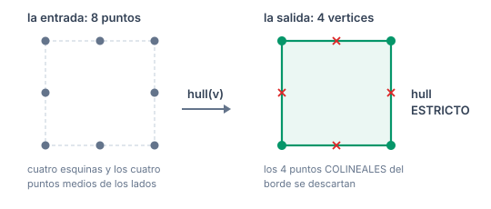
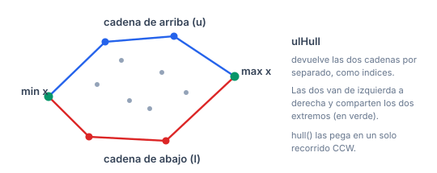
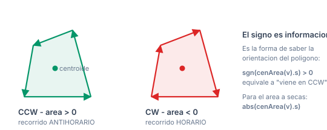
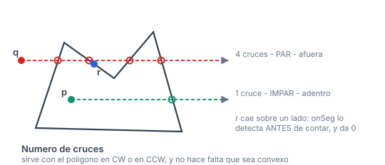
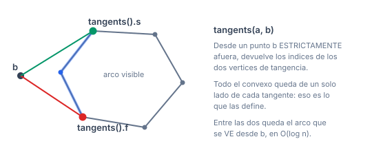
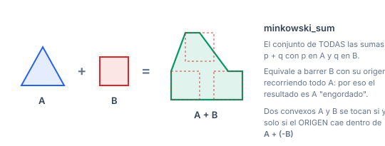
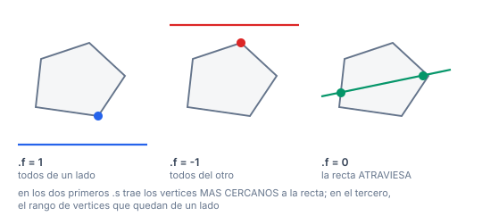
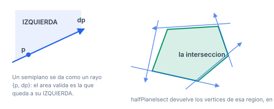

# Polygons

Convex hull, área, centroide, punto en polígono, diámetro, tangentes y suma de Minkowski. Es la sección que más aparece en contest.

## Índice

- [Cómo se arma la submission](#cómo-se-arma-la-submission)
  - [Qué hull elegir](#qué-hull-elegir)
- [Dos convenciones que hay que tener claras](#dos-convenciones-que-hay-que-tener-claras)
  - [1. El hull es ESTRICTO](#1-el-hull-es-estricto)
  - [2. `hull` es exacto, `inPoly` usa `EPS`](#2-hull-es-exacto-inpoly-usa-eps)
- [`ConvexHull.h`](#convexhullh)
  - [`ulHull`](#ulhull)
  - [`hullInd`](#hullind)
  - [`hull`](#hull)
- [`ConvexHullGraham.h`](#convexhullgrahamh)
  - [`hullInd` y `hull`](#hullind-y-hull)
- [`PolygonCenArea.h`](#polygoncenareah)
  - [`cenArea`](#cenarea)
- [`InPolygon.h`](#inpolygonh)
  - [`inPoly`](#inpoly)
- [`HullDiameter.h`](#hulldiameterh)
  - [`diameter2`](#diameter2)
- [`HullTangents.h`](#hulltangentsh)
  - [`lower` (variable global)](#lower-variable-global)
  - [`better`](#better)
  - [`tangent`](#tangent)
  - [`tangents`](#tangents)
- [`MinkowskiSum.h`](#minkowskisumh)
  - [`minkowski_sum`](#minkowski_sum)
- [`LineHull.h`](#linehullh)
  - [`extrVertex`](#extrvertex)
  - [`lineHull`](#linehull)
- [`HalfPlaneIsect.h`](#halfplaneisecth)
  - [`Ray` (el tipo de entrada)](#ray-el-tipo-de-entrada)
  - [`halfPlaneIsect`](#halfplaneisect)
- [Casos de uso recurrentes, de punta a punta](#casos-de-uso-recurrentes-de-punta-a-punta)
  - [Área de un polígono (entero y exacto)](#área-de-un-polígono-entero-y-exacto)
  - [¿Está en CCW o en CW?](#está-en-ccw-o-en-cw)
  - [Máxima distancia entre puntos](#máxima-distancia-entre-puntos)
  - [Punto en polígono convexo en O(log n)](#punto-en-polígono-convexo-en-olog-n)
  - [¿Chocan estos dos convexos?](#chocan-estos-dos-convexos)
  - [Máxima área de un triángulo con vértices del conjunto](#máxima-área-de-un-triángulo-con-vértices-del-conjunto)
  - [¿La recta corta al convexo? (en O(log n))](#la-recta-corta-al-convexo-en-olog-n)
  - [El núcleo de un polígono (desde dónde se ve todo el interior)](#el-núcleo-de-un-polígono-desde-dónde-se-ve-todo-el-interior)
  - [Cuántos puntos caen sobre el borde del hull](#cuántos-puntos-caen-sobre-el-borde-del-hull)
- [Verificación](#verificación)
- [Lo que no está](#lo-que-no-está)

## Cómo se arma la submission

Copiás `templateHeavy.cpp` en `E.cpp` y pegás el **código** de los headers que necesites en la sección de template.

> **Los `#include` no van en la solución.** Ningún header de esta librería tiene `#include`. El campo `Requiere:` del encabezado es solo un **indicador** de qué otros templates hay que pegar también, y en qué orden.

| si pegás | pegá antes |
|---|---|
| `ConvexHull.h` *(o `ConvexHullGraham.h`)* | `Point.h` |
| `PolygonCenArea.h` | `Point.h` |
| `InPolygon.h` | `Point.h` |
| `HullTangents.h` | `Point.h` |
| `MinkowskiSum.h` | `Point.h` |
| `LineHull.h` | `Point.h` |
| `HalfPlaneIsect.h` | `Point.h`, **`AngleCmp.h`** |
| `HullDiameter.h` | `Point.h`, **un hull** (usa `hull()`) |

`HullDiameter.h` es el único que depende de otro header de esta carpeta: llama a `hull()`, así que antes tiene que estar pegado `ConvexHull.h` o `ConvexHullGraham.h` (cualquiera de los dos sirve, verificado).

> **`ConvexHull.h` y `ConvexHullGraham.h` son alternativas, no complementos.** Los dos definen `hullInd` y `hull`; pegar los dos da `redefinition of 'vi hullInd(const vP&)'`. Elegí uno. Los dos sirven de base para `HullDiameter` y `MinkowskiSum`.

### Qué hull elegir

| | `ConvexHull.h` | `ConvexHullGraham.h` |
|---|---|---|
| algoritmo | cadena monótona (Andrew) | Graham scan |
| ordena por | coordenada | ángulo alrededor del punto más bajo |
| extra | expone `ulHull` (cadenas de arriba y abajo separadas) | — |
| líneas | 34 | 27 |

En la práctica da igual: los dos son $O(n \log n)$ y los verifiqué contra la misma referencia. **Usá `ConvexHull.h`** salvo que necesites las dos cadenas por separado... que es justo lo que `ConvexHull.h` te da de más. O sea: usá `ConvexHull.h`.

## Dos convenciones que hay que tener claras

### 1. El hull es ESTRICTO

Los dos descartan los puntos **colineales del borde**: solo devuelven las esquinas verdaderas. Con los puntos de un cuadrado más los medios de cada lado, devuelve 4 vértices, no 8.



Si un problema te pide *"cuántos puntos están en el borde del hull"*, el hull no te lo contesta directo: tenés que recorrer los lados y contar con `onSeg`.

### 2. `hull` es exacto, `inPoly` usa `EPS`

Esto es sutil y vale la pena saberlo:

| rutina | cómo decide | tolera $10^{-12}$ |
|---|---|---|
| `hull`, `hullInd`, `ulHull` | `cross(...) >= 0` **crudo** | no |
| `inPoly` | `onSeg`, que usa `sgn` | **sí** |

Medido sobre un cuadrado de lado 10:

```
punto a 1e-12 del borde   ->  inPoly dice EN EL BORDE
punto a 1e-12 AFUERA      ->  inPoly dice EN EL BORDE
hull con desvio de 1e-13  ->  lo trata como vertice real
```

**Con coordenadas enteras da exactamente lo mismo**, y ahí el comportamiento exacto del hull es el ideal. Con coordenadas fraccionarias las dos rutinas se contradicen sobre qué significa "estar en el borde".

> Si el problema trae enteros, poné `T = ll`: los `cross` quedan exactos y la discusión desaparece.

---

## `ConvexHull.h`

**Requiere:** `Point.h` · $O(n \log n)$

### `ulHull`

```cpp
pair<vi,vi> ulHull(const vP& v);
```

Las dos cadenas del hull por separado, como **índices** sobre `v`: `.f` es la cadena de **arriba** (*upper*), `.s` la de **abajo** (*lower*). Las dos van de izquierda a derecha, y comparten el punto más a la izquierda y el más a la derecha.



- Complejidad: $O(n \log n)$ — domina el sort.
- Casos de uso: cuando necesitás las mitades por separado. Los dos clásicos:
  - **Convex Hull Trick** geométrico: la envolvente superior de un conjunto de puntos es el máximo de las rectas duales.
  - Recorrer "el techo" o "el piso" de una nube de puntos.

> Es la función interna de `hullInd`, pero es pública porque suelta sirve.

### `hullInd`

```cpp
vi hullInd(const vP& v);
```

Los **índices** de los vértices del hull, en orden **antihorario (CCW)**.

- Complejidad: $O(n \log n)$.
- Casos borde: con un punto devuelve 1 índice; con todos los puntos iguales devuelve `{0}`; con todos colineales devuelve los 2 extremos.
- Caso de uso: cuando necesitás saber **qué puntos originales** quedaron en el hull, no solo sus coordenadas — por ejemplo si cada punto trae un id, un peso o un color.

### `hull`

```cpp
vP hull(const vP& v);
```

Los **puntos** del hull, en orden antihorario. Es `hullInd` mapeado a coordenadas.

- Complejidad: $O(n \log n)$.
- Casos de uso: lo que pide casi cualquier problema de hull. Es la entrada de `diameter2`, `cenArea`, `inPoly`, `tangents` y `minkowski_sum`.

**Verificación:** 14.800 casos contra una cadena monótona independiente escrita en `ll` exacto, comparando el **conjunto** de vértices, el **área** y que el orden sea CCW, con $C$ de 2 a $10^9$. Más 12 casos borde explícitos (1 punto, todos duplicados, colineales en tres orientaciones, cuadrado con puntos en el borde). 0 diferencias.

---

## `ConvexHullGraham.h`

**Requiere:** `Point.h` · $O(n \log n)$

### `hullInd` y `hull`

Misma interfaz y mismo resultado que los de `ConvexHull.h`, por Graham scan: toma el punto más bajo-izquierda, ordena el resto por ángulo alrededor de él (desempatando por distancia) y hace una pasada con una pila.

- Complejidad: $O(n \log n)$.
- También devuelve el hull **estricto**, en CCW.

**Verificación:** 8.000 casos contra la misma referencia que `ConvexHull.h`, incluyendo $C=2$. 0 diferencias.

> Con coordenadas enteras conviene `T = ll`: el comparador por ángulo usa `cross`, y con enteros queda exacto.

---

## `PolygonCenArea.h`

**Requiere:** `Point.h` · $O(n)$

### `cenArea`

```cpp
pair<P,T> cenArea(const vP& v);
```

Devuelve `{centroide, área con signo}` de un polígono **simple** (no se auto-intersecta). No hace falta que sea convexo.



- Complejidad: $O(n)$.
- **Precondición: al menos 3 vértices.** Un `assert` lo verifica.
- **El área viene CON SIGNO:** positiva si `v` está en CCW, negativa si está en CW. Para el área a secas:

```cpp
T area = abs(cenArea(v).s);
```

- El signo es útil por sí mismo: **es la forma de saber la orientación de un polígono**.
- El centroide es el **centro de masa de la superficie**, con densidad constante. No es el promedio de los vértices (ese es el centroide de los vértices, que es otra cosa).
- Casos de uso:
  - Área de un polígono — la fórmula del cordón de zapato (*shoelace*).
  - Detectar la orientación: `sgn(cenArea(v).s) > 0` ⟺ CCW.
  - Centro de masa de una placa poligonal (física, equilibrio).
  - Área de la intersección de un polígono con algo, por descomposición en triángulos.

> **Con `T = ll` las dos divisiones truncan.** Si trabajás con enteros y solo querés el área, acumulá el doble del área a mano:
> ```cpp
> ll area2 = 0;
> F0R(i, sz(v)) { int j = (i+1)%sz(v); area2 += (ll)cross(v[i], v[j]); }
> // |area2| es el DOBLE del area, exacto
> ```
> Es el idioma habitual en problemas con enteros: trabajar con $2A$ evita dividir y mantiene todo exacto.

**Verificación:** área contra un *shoelace* independiente, signo positivo para el hull en CCW, y el centroide siempre adentro del hull. 0 fallas en 44.000 casos.

---

## `InPolygon.h`

**Requiere:** `Point.h` · $O(n)$

### `inPoly`

```cpp
int inPoly(const P& p, const vP& poly);
```

Dice dónde cae `p` respecto del polígono **simple** `poly`.

| valor | significado |
|---|---|
| `-1` | **adentro** |
| `0` | sobre el **borde** |
| `1` | **afuera** |

- Complejidad: $O(n)$.
- **Sirve con el polígono en CW o en CCW** — no hace falta normalizar la orientación. Verificado en los dos sentidos.
- No hace falta que sea convexo: funciona con cualquier polígono simple.
- Algoritmo: número de cruces (*ray casting*). Tira un rayo y cuenta cuántos lados atraviesa; impar es adentro. El borde se chequea aparte, con `onSeg`, **antes** de contar.



La razón de que funcione: cada vez que el rayo cruza el borde, pasa de adentro a afuera o al revés. Como arranca en el infinito —afuera seguro—, la **paridad** del número de cruces dice dónde terminó. Por eso no importa la orientación del polígono ni que sea convexo.
- Casos de uso: ¿el punto está en la región?; contar cuántos puntos caen dentro de un recinto; validar una posición en un mapa poligonal.

> Para un polígono **convexo** y muchas consultas, $O(n)$ por consulta es caro. Con el hull ordenado se puede responder en $O(\log n)$ con búsqueda binaria angular, o con `tangents`. Ni esta librería ni la de Benq traen esa rutina hecha.

**Verificación:** 170.000 casos contra un *crossing number* exacto en `ll`, de los cuales **104.000 son casos de borde** (vértices y puntos medios de lados), en CW y en CCW, con $C$ de 4 a 1000. 0 diferencias.

---

## `HullDiameter.h`

**Requiere:** `Point.h`, `ConvexHull.h` · $O(n \log n)$

### `diameter2`

```cpp
T diameter2(vP ps);
```

El **cuadrado** de la mayor distancia entre dos puntos del conjunto. No hace falta pasarle el hull: lo calcula adentro.

- Complejidad: $O(n \log n)$ en total ($O(n)$ el barrido de *calipers*, el resto es el hull).
- **Devuelve el cuadrado**, no la distancia. Con coordenadas enteras eso lo mantiene **exacto**; si querés la distancia, `sqrt(diameter2(ps))`.
- Algoritmo: *rotating calipers*. El par más lejano está siempre en el hull, y se lo encuentra rotando un par de rectas de soporte paralelas.
- Casos de uso: el par de puntos más alejados (*Robert Hood* en Kattis); el diámetro de una nube; el lado mínimo de un cuadrado que cubre todo (combinado con otras direcciones).

> El parámetro se llama `ps` y no `P`: en el original de Benq se llamaba `P`, que **tapa el tipo punto** dentro de la función. También devolvía `db` cuando el valor es un `T`.

**Verificación:** contra fuerza bruta $O(n^2)$ sobre todos los pares, en 44.000 casos con $C$ de 3 a $10^5$. 0 diferencias.

---

## `HullTangents.h`

**Requiere:** `Point.h` · $O(\log n)$

Las dos tangentes desde un punto de **afuera** a un polígono **convexo**. Es la pieza que te da consultas en tiempo logarítmico sobre un hull fijo.

### `lower` (variable global)

```cpp
bool lower;
```

Un **estado global mutable** que le dice a `better` cuál de las dos tangentes se está buscando. `tangents` lo setea antes de cada llamada.

> No es reentrante y es frágil. **No llames a `tangent` directo sin setear `lower` primero** — usá `tangents`, que se encarga. Y si tenés una variable propia llamada `lower`, renombrala (no choca con `templateHeavy.cpp`, lo verifiqué).

### `better`

```cpp
bool better(P a, P b, P c);
```

El predicado de comparación que guía las búsquedas binarias: según `lower`, dice si el giro `a→b→c` es a derecha o a izquierda.

- Complejidad: $O(1)$.
- Es un detalle de implementación; normalmente no se llama suelto.

### `tangent`

```cpp
int tangent(const vP& a, P b);
```

El **índice** del vértice de tangencia, para la tangente que indique `lower`.

- Complejidad: $O(\log n)$, con tres búsquedas binarias.
- **Precondiciones:** `a` es convexo, en CCW, **sin tres puntos colineales** (el hull estricto de esta librería cumple), y `b` está **estrictamente afuera**.

> El nombre `tangent` **también lo usa `CircleTangents.h`**. Conviven por sobrecarga (uno toma `(P, Circ, int)`, el otro `(const vP&, P)`), lo verifiqué compilando los dos juntos. Pero es confuso: si pegás los dos, mirá bien qué estás llamando.

### `tangents`

```cpp
pi tangents(const vP& a, P b);
```

Los **dos** índices de tangencia de una vez: `{inferior, superior}`. Es la que querés usar.



Lo que define una tangente es que **todo el polígono queda de un solo lado** de ella. Entre las dos queda el arco que se ve desde el punto, y ese arco es exactamente lo que habría que reemplazar si agregaras el punto al hull.

- Complejidad: $O(\log n)$.
- Mismas precondiciones que `tangent`.
- Casos de uso:
  - **El arco visible** del polígono desde un punto: los dos índices delimitan la parte que se ve.
  - **Punto en polígono convexo en $O(\log n)$**: si las tangentes no existen, el punto está adentro.
  - El ángulo con que se ve un polígono desde un punto.
  - Caminos más cortos esquivando un obstáculo convexo.
  - Agregar un punto a un hull en $O(\log n)$: lo que hay que reemplazar es justo lo que queda entre las dos tangentes.

**Verificación:** 131.679 consultas desde puntos en **todas las direcciones** alrededor del polígono, cerca y lejos, comprobando (a) la propiedad de tangencia —ningún vértice del lado prohibido— y (b) que los índices devueltos coinciden con los de una fuerza bruta $O(n^2)$. 0 fallas.

---

## `MinkowskiSum.h`

**Requiere:** `Point.h` · $O(n + m)$

### `minkowski_sum`

```cpp
vP minkowski_sum(vP a, vP b);
```

La **suma de Minkowski** de dos polígonos convexos: el conjunto $\{p + q : p \in A,\ q \in B\}$. El resultado es convexo y queda en CCW.



La imagen mental: es barrer $B$ con su origen recorriendo todo $A$. El resultado es $A$ "engordado" con la forma de $B$, y sus lados son los lados de $A$ y los de $B$ **mezclados por ángulo** — de ahí que el algoritmo sea una fusión lineal de dos listas ya ordenadas.

- Complejidad: $O(n + m)$ — lineal, gracias a que las dos entradas ya están ordenadas por ángulo.
- **Precondición: `a` y `b` son convexos y vienen en CCW.** Pasales `hull(...)` si no estás seguro.
- Casos degenerados manejados: entrada vacía devuelve vacío; un polígono de un solo punto devuelve el otro **trasladado**; un segmento más un segmento da un paralelogramo. Todos verificados.
- El resultado puede traer vértices colineales; si molesta, `hull(minkowski_sum(a,b))`.
- Casos de uso:
  - **Colisión de dos convexos que se mueven:** $A$ y $B$ se tocan si y solo si el origen está en $A \oplus (-B)$. Reduce "¿chocan?" a "¿el origen está en este polígono?".
  - **Diámetro** de un convexo: $\max |p-q|$ sobre $A \oplus (-A)$.
  - **Distancia mínima** entre dos convexos: la distancia del origen a $A \oplus (-B)$.
  - Suma de conjuntos de vectores alcanzables, en problemas de DP geométrica.

> El original de Benq trae un `diameter2` de ejemplo que **choca** con el de `HullDiameter.h`. Lo omití: usá el de `HullDiameter.h`.

**Verificación:** contra el **hull de todas las sumas** $p+q$ (referencia $O(nm)$), en 44.000 casos, más las ramas degeneradas una por una. 0 diferencias.

---

## `LineHull.h`

**Requiere:** `Point.h` · $O(\log n)$

Consultas de recta contra polígono convexo en tiempo logarítmico, sobre un hull que no cambia.

### `extrVertex`

```cpp
int extrVertex(const vP& poly, P nrm);
```

El **índice del vértice de máxima proyección** sobre la dirección `nrm`: el punto del convexo que queda más lejos en ese sentido.

- Complejidad: $O(\log n)$, por búsqueda binaria sobre la forma del convexo.
- **Precondición: `poly` es convexo y viene en CCW.**
- Casos de uso: el punto extremo en una dirección (lo que pide un *rotating calipers* puntual); la recta de soporte del convexo en una dirección dada; maximizar $\mathbf{nrm} \cdot p$ sobre el convexo, que es un programa lineal de dos variables resuelto en $O(\log n)$.

> El parámetro se llama `nrm` y no `dir` como en el original: `dir` es una **función** de `Point.h`, y usarla como nombre de variable la tapa dentro del cuerpo.

### `lineHull`

```cpp
pair<int,vi> lineHull(Line line, const vP& poly);
```

Dice cómo corta la **recta infinita** `line` al convexo `poly`. El primer componente dice el caso, el segundo los índices relevantes:



| `.f` | significado | `.s` |
|---|---|---|
| `1` | **todos** los vértices están de un lado (arriba) | los vértices **más cercanos** a la recta (1 o 2) |
| `-1` | todos del otro lado (abajo) | idem |
| `0` | la recta **atraviesa** el convexo | el rango de vértices que quedan sobre o debajo |

- Complejidad: $O(\log n)$.
- **Precondiciones:** `poly` convexo en CCW, al menos 2 vértices (un `assert` lo verifica), y `line.f != line.s`.
- Casos de uso:
  - **¿La recta corta al polígono?** El signo lo contesta solo, sin recorrer los vértices.
  - Las **dos aristas** por donde entra y sale la recta, para después calcular los puntos exactos con `lineIsect`.
  - La **distancia** de una recta a un convexo: cuando `.f` es $\pm 1$, los vértices devueltos son los más cercanos.
  - Recortar un convexo por una recta en $O(\log n)$ en lugar de $O(n)$.

> Usa el `Line = pair<P,P>` de tu `Point.h`. El original de Benq define `Line` como `array<P,2>`, que choca de frente (17 errores); al adaptarlo se compone directo con `lineIsect`, `segDist` y `onSeg`.

**Verificación:** 25.972 casos contra fuerza bruta, chequeando las cuatro cosas: que `extrVertex` alcance el máximo real de la proyección, que el signo coincida con contar de qué lado cae cada vértice, que los índices del caso `0` marquen aristas que de verdad cruzan la recta, y que los del caso $\pm 1$ sean los de distancia mínima. Las tres ramas quedaron cubiertas (11.455 cruces, 1.530 de un lado). 0 fallas.

---

## `HalfPlaneIsect.h`

**Requiere:** `Point.h`, `AngleCmp.h` · $O(n \log n)$

### `Ray` (el tipo de entrada)

```cpp
struct Ray { P p, dp; };   // origen, direccion
```

Un semiplano se describe como el **área a la izquierda** del rayo que sale de `p` en dirección `dp`. Trae dos métodos:



- `isect(const Ray& L)` — el punto donde se cortan las dos rectas de soporte. $O(1)$. Divide por `cross(L.dp, dp)`, así que **no sirve con rayos paralelos**.
- `operator<` — ordena por ángulo de `dp`, delegando en `angleCmp`. Es lo que permite el $O(n \log n)$.

### `halfPlaneIsect`

```cpp
vP halfPlaneIsect(V<Ray> rays, bool add_bounds = false);
```

Los **vértices de la intersección** de todos los semiplanos, en orden CCW. Si la intersección es vacía devuelve un vector vacío.

- Complejidad: $O(n \log n)$ — lo domina el ordenamiento por ángulo.
- **Precondición: la intersección tiene que ser acotada y de área no nula.** Si no lo es, salta el `assert(sz(poly) >= 3)`.
- `add_bounds = true` agrega los cuatro semiplanos del rectángulo $[0,10^9]^2$, que es la forma rápida de acotar una intersección que de por sí sería infinita. Ojo: eso fuerza el resultado al primer cuadrante.
- **Precisión:** el área sale confiable con **enteros de magnitud $\le 10^5$**, según documenta Benq. Internamente compara `cross` contra `EPS` directamente en lugar de pasar por `sgn`, y de ahí sale ese techo.
- Casos de uso:
  - **El área visible** desde un punto dentro de un recinto poligonal.
  - El **núcleo** de un polígono (el conjunto de puntos que ven todo el interior): es la intersección de los semiplanos de sus lados.
  - **Programación lineal en 2D**: la región factible de un sistema de desigualdades $a x + b y \le c$.
  - Intersección de varios convexos, que es un caso particular.
  - Problemas de "¿dónde puedo pararme?" con varias restricciones lineales.

Cómo construir el semiplano a partir de una desigualdad: $ax + by \le c$ es el lado izquierdo del rayo con origen en cualquier punto de la recta y dirección `perp(P(a,b))` negada — en la práctica es más simple pensar en los lados de un polígono CCW, donde cada lado `(v[i], v[i+1])` da el rayo `{v[i], v[i+1]-v[i]}`.

> Agregué una guarda `if (sz(poly) < 3) return {};` antes del bucle final. Sin ella, con menos de 3 rayos el `poly[1]` del bucle lee fuera de rango; con la guarda devuelve vacío, que es la misma respuesta que ya daba para entradas degeneradas. No cambia nada para entrada válida.
>
> El `#define reduce(...)` del original **no tenía `#undef`** y se filtraba al resto del archivo. `reduce` es además el nombre de `std::reduce`, así que un macro con ese nombre es peligroso; ahora se cierra justo después del último uso.

**Verificación:** 9.500 casos contra **Sutherland-Hodgman** (recorte sucesivo por un semiglano a la vez), comparando áreas. Primero reproduciendo exactamente un convexo a partir de los semiplanos de sus lados (3.000 casos, ningún degenerado), y después con hasta 5 semiplanos extra que lo cortan, con $C$ de 20 a 1000. 0 diferencias.

---

## Casos de uso recurrentes, de punta a punta

### Área de un polígono (entero y exacto)

```cpp
ll area2 = 0;
F0R(i, sz(v)) { int j = (i+1)%sz(v); area2 += (ll)cross(v[i], v[j]); }
// abs(area2) es el DOBLE del area
```

### ¿Está en CCW o en CW?

```cpp
bool ccw = sgn(cenArea(v).s) > 0;
```

### Máxima distancia entre puntos

```cpp
T d2 = diameter2(ps);        // al cuadrado, exacto con enteros
db d  = sqrt((db)d2);
```

### Punto en polígono convexo en O(log n)

```cpp
vP h = hull(ps);                       // una vez
// por consulta: si el punto esta adentro, no hay tangentes validas
bool adentro = (inPoly(b, h) != 1);    // O(n); con tangents sale en O(log n)
```

### ¿Chocan estos dos convexos?

```cpp
vP a = hull(A), b = hull(B);
each(p, b) p *= -1;
vP ms = hull(minkowski_sum(a, hull(b)));
bool chocan = (inPoly(P{0,0}, ms) != 1);
```

### Máxima área de un triángulo con vértices del conjunto

```cpp
vP h = hull(ps);     // los tres vertices optimos estan en el hull
// despues, rotating calipers o O(n^2) sobre h
```

### ¿La recta corta al convexo? (en O(log n))

```cpp
vP h = hull(ps);                             // una vez
if (sgn(cenArea(h).s) < 0) reverse(all(h));  // lineHull pide CCW
// por consulta:
auto r = lineHull(Line{a, b}, h);
bool corta = (r.f == 0);
// y si corta, los puntos exactos salen de las dos aristas que devuelve
```

### El núcleo de un polígono (desde dónde se ve todo el interior)

```cpp
V<Ray> rays; int n = sz(poly);               // poly simple, en CCW
F0R(i, n) rays.pb({poly[i], poly[(i+1)%n] - poly[i]});
vP nucleo = halfPlaneIsect(rays);
bool hay = sz(nucleo) >= 3;                  // vacio si no existe tal punto
```

### Cuántos puntos caen sobre el borde del hull

```cpp
vP h = hull(ps); int m = sz(h), cnt = 0;
each(p, ps) F0R(i, m) if (onSeg(p, Line{h[i], h[(i+1)%m]})) { ++cnt; break; }
```

Hace falta porque el hull es **estricto** y no devuelve los colineales.

---

## Verificación

| rutina | casos | contra |
|---|---|---|
| `tangents`, `tangent` | 131.679 | propiedad de tangencia + fuerza bruta $O(n^2)$ |
| `inPoly` | 170.000 (104.000 de borde) | *crossing number* exacto, CW y CCW |
| `cenArea`, `diameter2`, `minkowski_sum` | 44.000 | *shoelace*, $O(n^2)$ y hull de todas las sumas |
| `hull`, `hullInd`, `ulHull` | 14.800 + 12 bordes | cadena monótona exacta en `ll`, $C$ de 2 a $10^9$ |
| `hull` (Graham) | 8.000 | misma referencia |
| `extrVertex`, `lineHull` | 25.972 | fuerza bruta: máximo real, signo, aristas cruzadas y cercanía |
| `halfPlaneIsect` | 9.500 | Sutherland-Hodgman, recorte sucesivo |

Los nueve headers compilan juntos (menos Graham, que es alternativa de `ConvexHull.h`) con las flags del `Makefile` sin warnings.

## Lo que no está

- **Punto en polígono convexo en $O(\log n)$** como rutina propia. `inPoly` es $O(n)$; se saca de `tangents` o con búsqueda binaria angular en ~10 líneas. Benq tampoco la tiene.
- **`HalfPlaneSet.h`** de cp-notebook (intersección de semiplanos *online*, con inserciones). Quedó afuera: redefine `T` como `int`, más `INF` y `Line` (32 errores contra esta librería), es de otro autor y su `Maximize` está marcado UNTESTED por Benq. Para el caso offline está `HalfPlaneIsect.h`.

Con eso, de los 36 headers de geometría de cp-notebook quedan afuera solo: `3D` (5), `Delaunay` (3), `KD-tree` (2), `HalfPlaneSet`, `_old_HalfPlaneIsect`, y los tres reemplazos de `Point.h` (`Complex`, `ComplexComp`, `PointShort`).
