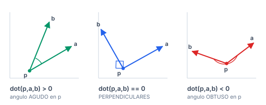
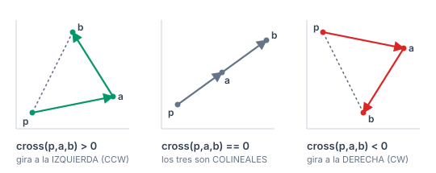
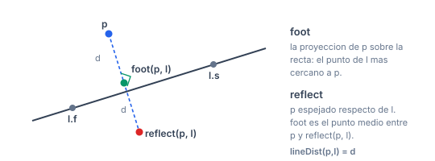
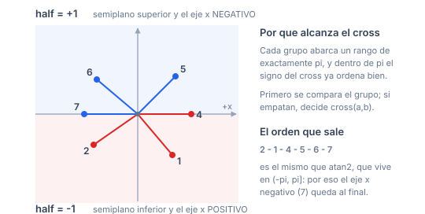
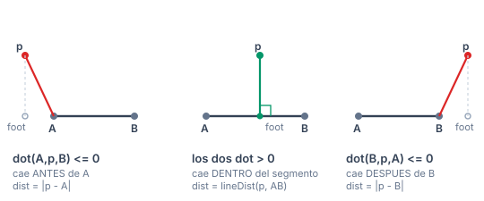
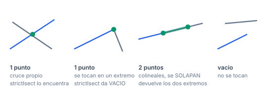
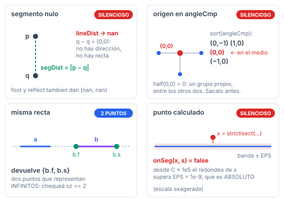

# Primitives

El tipo punto y todo lo que se construye sobre él. `Circles`, `Polygons` y `Misc` se apoyan en `Point.h`.

Manual de consulta: **qué hace cada método, qué le podés pasar y hasta dónde aguanta.** Los problemas donde practicar están en [PROBLEMS.md](../PROBLEMS.md).

## Índice

- [Cómo se arma la submission](#cómo-se-arma-la-submission)
- [Contrato de tipos](#contrato-de-tipos)
  - [Elegir `T`: `db` o `ll`](#elegir-t-db-o-ll)
  - [Hasta dónde aguanta `db`](#hasta-dónde-aguanta-db)
  - [Puntos calculados: el límite del `EPS`](#puntos-calculados-el-límite-del-eps)
- [`Point.h`](#pointh)
  - [Operadores](#operadores)
  - [`sgn`, `sq`](#sgn-sq)
  - [`abs2`, `abs`](#abs2-abs)
  - [`arg`, `dir`](#arg-dir)
  - [`conj`, `perp`, `unit`](#conj-perp-unit)
  - [`dot`](#dot)
  - [`cross`](#cross)
  - [`reflect`, `foot`](#reflect-foot)
  - [`onSeg`](#onseg)
- [`AngleCmp.h`](#anglecmph)
  - [`half`](#half)
  - [`angleCmp`](#anglecmp)
- [`SegDist.h`](#segdisth)
  - [`lineDist`](#linedist)
  - [`segDist`](#segdist)
- [`SegIsect.h`](#segisecth)
  - [`lineIsect`](#lineisect)
  - [`strictIsect`](#strictisect)
  - [`segIsect`](#segisect)
- [Casos degenerados](#casos-degenerados)
- [Ejemplo completo](#ejemplo-completo)
- [Verificación](#verificación)

## Cómo se arma la submission

Copiás `templateHeavy.cpp` en `E.cpp` y pegás el **código** del header en la sección de template.

> **Los `#include` no van en la solución.** El campo `Requiere:` es solo un indicador de qué más pegar, y en qué orden.

| si pegás | pegá antes |
|---|---|
| `AngleCmp.h`, `SegDist.h`, `SegIsect.h` | `Point.h` |

## Contrato de tipos

```cpp
using T = db;                   // el escalar: db = long double, o ll
const T EPS = 1e-9;
using P = pair<T,T>;            // un punto, o un vector
using vP = V<P>;
using Line = pair<P,P>;         // dos puntos: una recta, o un segmento
```

`P` es a la vez **punto** y **vector**. `Line` es a la vez **recta infinita** y **segmento** — cuál de las dos lo decide la función que lo recibe, y está dicho en cada una.

### Elegir `T`: `db` o `ll`

| | `T = db` (default) | `T = ll` |
|---|---|---|
| predicados (`sgn`, `cross`, `dot`) | con `EPS` | **exactos** |
| métrica (`abs`, `arg`, `unit`, `foot`, `reflect`) | correctos | **truncan en silencio** |

Con `T = ll`, `EPS = 1e-9` trunca a `0` y `sgn` se vuelve exacto — eso es deseable. Pero `abs({1,1})` devuelve `1` en vez de $\sqrt 2$, y `arg` devuelve `0` casi siempre.

**Regla:** coordenadas enteras y solo orientación, área o comparar distancias → `T = ll`, sin usar `abs`/`arg`/`unit`. Distancias o ángulos reales → `T = db`.

### Hasta dónde aguanta `db`

En todo el manual, **$C$ = la mayor coordenada en valor absoluto** de los puntos de entrada: $|c| \le C$.

**Cuánto valen los productos.** Verificado por fuerza bruta sobre todas las ternas de la grilla $[-C, C]^2$:

| expresión | máximo | con `ll` entra hasta |
|---|---|---|
| `cross(p,a,b)` | $4C^2$ | $C \approx 1{,}5 \cdot 10^9$ |
| `dot(p,a,b)` | $8C^2$ | $C \approx 1{,}07 \cdot 10^9$ |
| `abs2(a-b)` | $8C^2$ | $C \approx 1{,}07 \cdot 10^9$ |
| `cross(a,b)` de vectores con componentes $\le C$ | $2C^2$ | $C \approx 2{,}1 \cdot 10^9$ |

Con `ll` los predicados son **exactos** hasta esos límites. El típico $C = 10^9$ entra en todos.

**Con flotantes el problema no es el desborde sino la cancelación.** Peor caso real: `a` y `b` casi colineales con `p`, `cross` verdadero entre 1 y 4, coordenadas de magnitud $C$. 20.000 casos por celda, signo contra `__int128`:

| $C$ | `long double` (64 bits de mantisa) | `double` (53 bits) |
|---|---|---|
| $2 \cdot 10^7$ | 0% mal | 0% mal |
| $5 \cdot 10^7$ | 0% mal | **2,6% mal** |
| $10^8$ | 0% mal | **41,3% mal** |
| $10^9$ | **0% mal** | inservible |
| $3 \cdot 10^9$ | 14,3% mal | inservible |
| $5 \cdot 10^9$ | 50,6% mal | inservible |

Umbral por búsqueda binaria: **`long double` exacto hasta $C \approx 2{,}1 \cdot 10^9$.**

> **No cambies `db` a `double` si usás geometría.** `templateHeavy.cpp` dice *"or double if tight TL"*; con `double` los predicados fallan desde $5 \cdot 10^7$, que es un rango de problema completamente normal.

Qué tipo de error es: en esta familia de peor caso, **todos** los errores medidos fueron "el `cross` colapsa a 0" (un caso casi degenerado se lee como colineal). **Ninguno** invirtió el signo, en 240.000 casos entre las dos precisiones.

### Puntos calculados: el límite del `EPS`

Todo lo anterior vale para puntos **de entrada**. Un punto **calculado** — la salida de `lineIsect`, `foot`, `reflect`, `isect` — trae error de redondeo, y ahí aparece otro límite: **`EPS = 1e-9` es absoluto**, mientras que el `cross` crece como $C^2$.

Medido: `x = strictIsect(a, b)` está, en teoría, sobre los dos segmentos. ¿Cuántas veces `onSeg(x, a) && onSeg(x, b)` dice que **no**?

| $C$ | `onSeg` dice `false` |
|---|---|
| $10^3$ | 0% |
| $10^4$ | 0% |
| $10^5$ | **0,5%** |
| $10^6$ | **79,9%** |
| $10^9$ | **87,7%** |

**Regla: `sgn` y `onSeg` sobre puntos calculados, solo hasta $C \approx 10^4$.** Por encima, decidí con la entrada original (por ejemplo, con el parámetro sobre el segmento) en vez de preguntarle a `onSeg`.

`in()` de `Circle.h` **no** tiene este problema — compara distancias, que escalan con $C$ y no con $C^2$: medido 0% de error hasta $C = 10^7$ con puntos calculados.

---

## `Point.h`

### Operadores

```cpp
P  operator+(P l, P r);      P  operator-(P l, P r);
P  operator*(P l, T r);      P  operator*(T l, P r);     P operator/(P l, T r);
P  operator*(P l, P r);      P  operator/(P l, P r);      // complejos
P& operator+=(P&, const P&); P& operator-=(P&, const P&);
P& operator*=(P&, const T&); P& operator/=(P&, const T&);
```

Suma y resta de vectores; escalado por un escalar (el escalar puede ir de cualquier lado).

**`P * P` y `P / P` son multiplicación y división de complejos**, no producto componente a componente:

- `a * b` **rota** `a` por el ángulo de `b` y **escala** por `|b|`.
- `a / b` da el cociente: su ángulo es el **ángulo orientado** de `b` a `a`.

**Restricciones**: `operator/(P,T)` con `r = 0` y `operator/(P,P)` con `r = (0,0)` dan `nan` · **Tipo**: cualquiera; `P*P` y `P/P` piden `db` · **Aguanta**: `+` y `-` llegan a $2C$; `P*P` multiplica coordenadas, con `ll` llega a $2C^2$ · **Complejidad**: $O(1)$.

### `sgn`, `sq`

```cpp
int sgn(T a);    // -1, 0, 1 con tolerancia EPS
T   sq(T a);     // a*a
```

`sgn` es **el único lugar donde entra `EPS`**. Todo lo que compare contra cero debería pasar por acá en vez de usar `== 0`.

**Restricciones**: ninguna · **Tipo**: cualquiera · **Aguanta**: **`EPS` es absoluto**: con puntos de entrada enteros no molesta, pero sobre puntos **calculados** solo tolera hasta $C \approx 10^4$ ([ver tabla](#puntos-calculados-el-límite-del-eps)); `sq` con `ll` desborda para $|a| > 3 \cdot 10^9$ · **Complejidad**: $O(1)$.

### `abs2`, `abs`

```cpp
T abs2(P p);   // x^2 + y^2
T abs(P p);    // sqrt(abs2(p))
```

**Para comparar distancias usá `abs2`**: evita la raíz y, con `T = ll`, es exacto.

**Restricciones**: ninguna · **Tipo**: `abs2` cualquiera (con `ll` es exacto); `abs` pide `db` — con `ll` trunca · **Aguanta**: `abs2(a-b)` llega a $8C^2$: con `ll` entra hasta $C \approx 1{,}07 \cdot 10^9$ · **Complejidad**: $O(1)$.

### `arg`, `dir`

```cpp
T arg(P p);     // atan2(p.s, p.f), rango (-pi, pi]
P dir(T ang);   // (cos ang, sin ang), el unitario de ese angulo
```

**Restricciones**: `arg({0,0})` devuelve `0` (no `nan`), pero el origen no tiene ángulo: tratalo aparte · **Tipo**: `db` · **Aguanta**: error relativo $\sim 10^{-18}$, no depende de $C$ · **Complejidad**: $O(1)$.

> **Para ordenar por ángulo no uses `arg`**: usá [`angleCmp`](#anglecmp). Es más rápido y exacto.

### `conj`, `perp`, `unit`

```cpp
P conj(P p);   // (x, -y)        refleja sobre el eje x
P perp(P p);   // (-y, x)        rota 90 grados antihorario
P unit(P p);   // p / abs(p)     mismo angulo, largo 1
```

**Restricciones**: **`unit({0,0})` devuelve `(nan, nan)`** — divide por cero sin avisar · **Tipo**: `conj` y `perp` cualquiera; `unit` pide `db` · **Aguanta**: `conj` y `perp` no multiplican: nunca desbordan · **Complejidad**: $O(1)$.

### `dot`

```cpp
T dot(P a, P b);           // producto escalar
T dot(P p, P a, P b);      // dot(a-p, b-p): el angulo EN p
```

Responde *"¿hacia adelante o hacia atrás?"*:



| `sgn(dot(p,a,b))` | el ángulo en `p` |
|---|---|
| `> 0` | agudo |
| `0` | recto |
| `< 0` | obtuso |

**Restricciones**: ninguna · **Tipo**: cualquiera; con `ll` es exacto · **Aguanta**: `dot(p,a,b)` llega a $8C^2$: con `ll` entra hasta $C \approx 1{,}07 \cdot 10^9$; con `long double` el signo es exacto hasta $C \approx 2{,}1 \cdot 10^9$ · **Complejidad**: $O(1)$.

### `cross`

```cpp
T cross(P a, P b);         // a.x*b.y - a.y*b.x
T cross(P p, P a, P b);    // cross(a-p, b-p): giro p -> a -> b
```

**La función más importante de la librería.** Es el **área con signo** del paralelogramo, y responde *"¿de qué lado?"*:



| `sgn(cross(p,a,b))` | significa |
|---|---|
| `> 0` | giro **antihorario**: `b` a la izquierda de `p→a` |
| `0` | **colineales** |
| `< 0` | giro **horario**: `b` a la derecha |

También: $|\mathrm{cross}(p,a,b)|$ es **el doble del área** del triángulo `pab`.

**Restricciones**: ninguna · **Tipo**: cualquiera; con `ll` es exacto · **Aguanta**: `cross(p,a,b)` llega a $4C^2$: con `ll` entra hasta $C \approx 1{,}5 \cdot 10^9$; con `long double` el signo es exacto hasta $C \approx 2{,}1 \cdot 10^9$; con `double`, solo hasta $\approx 2 \cdot 10^7$ ([tabla](#hasta-dónde-aguanta-db)) · **Complejidad**: $O(1)$.

### `reflect`, `foot`

```cpp
P reflect(P p, Line l);   // espejo de p respecto de la RECTA l
P foot(P p, Line l);      // pie de la perpendicular: el punto de l mas cercano a p
```

`foot` es el **punto medio** entre `p` y `reflect(p, l)` — por eso el código es literalmente `(p + reflect(p,l)) / 2`.



**Restricciones**: `l` es una **recta infinita**, no un segmento — `foot` puede caer fuera de `[l.f, l.s]`. **`l.f != l.s`**: con una recta nula da `(nan, nan)` sin avisar · **Tipo**: `db` · **Aguanta**: el resultado es un punto **calculado**: no lo pases a `onSeg` ni a `sgn` con $C \ge 10^5$ ([por qué](#puntos-calculados-el-límite-del-eps)) · **Complejidad**: $O(1)$.

### `onSeg`

```cpp
bool onSeg(P p, Line l);
```

¿`p` está sobre el **segmento** `l`? Usa `sgn`, así que es tolerante a `EPS`.

**Restricciones**: admite segmento degenerado (`l.f == l.s`), y ahí da `true` solo si `p` es ese punto · **Tipo**: cualquiera · **Aguanta**: con `p` **de entrada**, igual que `cross`; con `p` **calculado** (salida de `lineIsect`, `foot`, `isect`…) **falla desde $C \approx 10^5$ y es inservible desde $10^6$** — 80% de falsos negativos ([tabla](#puntos-calculados-el-límite-del-eps)) · **Complejidad**: $O(1)$.

```cpp
onSeg({1,1}, {{0,0},{2,2}})  ->  true
onSeg({0,0}, {{0,0},{0,0}})  ->  true      // segmento degenerado, p es el punto
onSeg({1,1}, {{0,0},{0,0}})  ->  false
```

---

## `AngleCmp.h`

**Requiere:** `Point.h`

### `half`

```cpp
int half(P x);
```

Parte el plano en dos mitades de exactamente $\pi$ cada una, que es lo que hace posible ordenar por ángulo sin `atan2`.



| valor | qué cae ahí |
|---|---|
| `-1` | semiplano inferior **y el eje $x$ positivo** |
| `0` | el origen |
| `1` | semiplano superior **y el eje $x$ negativo** |

**Restricciones**: ninguna · **Tipo**: cualquiera · **Aguanta**: no multiplica: nunca desborda · **Complejidad**: $O(1)$.

```cpp
half({5,0})   ->  -1      // eje x positivo va ABAJO
half({-5,0})  ->   1      // eje x negativo va ARRIBA
half({0,0})   ->   0
```

> **No lo declares `bool`.** Devuelve tres valores; con `bool` el orden sale mal en silencio. El header lo avisa.

### `angleCmp`

```cpp
bool angleCmp(P a, P b);
vP v; sort(all(v), angleCmp);
```

Ordena por ángulo antihorario alrededor del **origen**, con el mismo orden que `atan2`: rango $(-\pi, \pi]$, así que el eje $x$ negativo queda **al final**.

**Restricciones**: **sacá el origen antes de ordenar** — `half({0,0})` da `0`, que lo mete en un grupo propio entre los otros dos y el resultado no tiene sentido · **Tipo**: `ll` o `db`, los dos; solo usa `sgn` y `cross` · **Aguanta**: usa `cross(a,b)` de dos vectores; si son diferencias de puntos con $|c| \le C$, igual que `cross(p,a,b)` · **Complejidad**: $O(1)$ por comparación, $O(n \log n)$ el sort.

```cpp
// 8 direcciones, desordenadas
{(-1,-1) (0,1) (1,-1) (-1,0) (1,0) (0,-1) (-1,1) (1,1)}
  sort(angleCmp) ->
{(-1,-1) (0,-1) (1,-1) (1,0) (1,1) (0,1) (-1,1) (-1,0)}
   -135    -90    -45     0    45    90    135    180      <- atan2, creciente

// con el origen adentro, el resultado NO sirve:
{(1,0) (0,0) (-1,0) (0,-1)}  sort(angleCmp) ->  {(0,-1) (1,0) (0,0) (-1,0)}
                                                            ^^^^^ en el medio
```

> **No uses `atan2` directo.** Es más lento y pierde precisión; el header trae dos submissions de Codeforces como evidencia.

---

## `SegDist.h`

**Requiere:** `Point.h`

### `lineDist`

```cpp
T lineDist(P p, Line l);
```

Distancia de `p` a la **recta infinita** por `l.f` y `l.s`.

**Restricciones**: **`l.f != l.s`** — con recta nula devuelve `nan` sin avisar · **Tipo**: `db` · **Aguanta**: error relativo $\sim 10^{-18}$ · **Complejidad**: $O(1)$.

### `segDist`

```cpp
T segDist(P p, Line l);
```

Distancia de `p` al **segmento** `l`. Considera tres casos: la proyección cae antes del extremo, después, o adentro.



**Restricciones**: **admite segmento degenerado** — ahí devuelve la distancia al punto, no `nan` · **Tipo**: `db` · **Aguanta**: error relativo $\sim 10^{-18}$ · **Complejidad**: $O(1)$.

> **El error clásico: usar `lineDist` donde va `segDist`.** Da un valor **menor** y nada avisa.
>
> ```cpp
> lineDist({5,0}, {{0,0},{1,0}})  ->  0     // la recta y=0 pasa por (5,0)
> segDist ({5,0}, {{0,0},{1,0}})  ->  4     // el segmento termina en (1,0)
>
> lineDist({0,1}, {{0,0},{0,0}})  ->  nan   // recta nula
> segDist ({0,1}, {{0,0},{0,0}})  ->  1     // segmento nulo: distancia al punto
> ```

---

## `SegIsect.h`

**Requiere:** `Point.h`



### `lineIsect`

```cpp
vP lineIsect(Line a, Line b);
```

Corte de dos **rectas infinitas**.

| devuelve | cuándo |
|---|---|
| `{punto}` | se cortan en uno solo |
| `{b.f, b.s}` | son **la misma recta** (infinitos puntos) |
| `{}` | paralelas distintas |

**Restricciones**: `a.f != a.s` y `b.f != b.s` · **Tipo**: `db` (divide) · **Aguanta**: la decisión (se cortan / paralelas / misma recta) es exacta con entrada entera hasta el umbral de `cross`; el punto devuelto es **calculado** — no lo pases a `onSeg` con $C \ge 10^5$ · **Complejidad**: $O(1)$.

```cpp
lineIsect({{0,0},{2,2}}, {{0,2},{2,0}})  ->  {(1,1)}
lineIsect({{0,0},{1,0}}, {{0,1},{1,1}})  ->  {}                 // paralelas
lineIsect({{0,0},{1,0}}, {{2,0},{3,0}})  ->  {(2,0), (3,0)}     // misma recta
```

> La comparación interna va con `sgn`, no con `==`: con `T = db` dos cross nunca son exactamente iguales.

### `strictIsect`

```cpp
vP strictIsect(Line a, Line b);
```

El punto donde los dos **segmentos se cruzan de verdad**, en el **interior** de ambos. Tocarse en una punta **no** cuenta.

**Restricciones**: igual que `lineIsect` · **Tipo**: `db` (el punto sale de una división) · **Aguanta**: igual que `lineIsect` · **Complejidad**: $O(1)$.

```cpp
strictIsect({{0,0},{2,2}}, {{0,2},{2,0}})  ->  {(1,1)}
strictIsect({{0,0},{1,0}}, {{1,0},{2,0}})  ->  {}       // punta con punta: NO cuenta
```

### `segIsect`

```cpp
vP segIsect(Line a, Line b);
```

Intersección de dos **segmentos**, incluyendo puntas y solapamientos. **Admite segmentos degenerados.**

| devuelve | cuándo |
|---|---|
| `{}` | no se tocan |
| `{punto}` | se cruzan, o se tocan en una punta |
| `{p, q}` | se **solapan** en un tramo (sus dos extremos) |

**Restricciones**: ninguna; `a` y `b` pueden ser degenerados · **Tipo**: `db` · **Aguanta**: igual que `lineIsect`; sus `onSeg` internos son sobre extremos **de entrada**, así que no sufren el problema del `EPS` · **Complejidad**: $O(1)$.

```cpp
segIsect({{0,0},{1,0}}, {{2,0},{3,0}})  ->  {}                 // disjuntos
segIsect({{0,0},{1,0}}, {{1,0},{2,0}})  ->  {(1,0)}            // punta con punta
segIsect({{0,0},{3,0}}, {{1,0},{2,0}})  ->  {(1,0), (2,0)}     // solapados
```

---

## Casos degenerados



Rojo = falla **en silencio**; naranja = `assert`; azul = resultado válido que rompe una suposición común.

Todas las salidas son de correr el código.

| llamada | resultado | |
|---|---|---|
| `abs({0,0})` | `0` | ok |
| `arg({0,0})` | `0` | ok, pero el origen no tiene ángulo |
| `unit({0,0})` | **`(nan, nan)`** | silencioso |
| `foot(p, {q,q})` | **`(nan, nan)`** | silencioso |
| `lineDist(p, {q,q})` | **`nan`** | silencioso |
| `segDist(p, {q,q})` | la distancia a `q` | **no** es nan |
| `onSeg(q, {q,q})` | `true` | ok |
| `onSeg(p, {q,q})` con `p != q` | `false` | ok |
| `sort(angleCmp)` con el origen adentro | **orden sin sentido** | silencioso |
| `lineIsect` de la misma recta | `{b.f, b.s}` | 2 puntos, no 1 |
| `segIsect` de solapados | `{p, q}` | 2 puntos, no 1 |
| `onSeg(x, s)` con `x` **calculado** y $C \ge 10^5$ | **`false`** aunque esté encima | silencioso — 80% con $C = 10^6$ |

> **Ningún método de esta carpeta tiene `assert`.** Todo lo que sale mal sale como `nan` o como un valor plausible pero incorrecto. Si tu entrada puede traer puntos repetidos, chequealo vos.

## Ejemplo completo

Clasificar un punto contra un segmento, con las salidas intermedias:

```cpp
P a = {0,0}, b = {4,0}, p = {6,3};

cout << sgn(cross(a,b,p)) << "\n";   //  1      p esta a la IZQUIERDA de a->b
cout << cross(a,b,p) << "\n";        //  12     = 2 * area del triangulo abp
cout << dot(b,a,p) << "\n";          // -8      el angulo EN b
cout << sgn(dot(b,a,p)) << "\n";     // -1      OBTUSO en b
                                     //         => la proyeccion cae PASADO b

cout << lineDist(p, {a,b}) << "\n";  //  3      la recta y = 0
cout << segDist (p, {a,b}) << "\n";  //  3.6056 = |p - b|, porque cae pasado b

P f = foot(p, {a,b});
cout << f << "\n";                   //  (6,0)  <- FUERA del segmento [a,b]
cout << onSeg(f, {a,b}) << "\n";     //  0      por eso segDist != lineDist

P r = reflect(p, {a,b});
cout << r << "\n";                   //  (6,-3)
cout << (p + r) / 2 << "\n";         //  (6,0)  el punto medio ES foot
```

Los mismos degenerados, en la misma rutina:

```cpp
Line nulo = {{2,2},{2,2}};
cout << lineDist(p, nulo) << "\n";   //  nan       <- sin aviso
cout << segDist (p, nulo) << "\n";   //  4.1231    = |p - (2,2)|, correcto
cout << foot(p, nulo) << "\n";       //  (nan,nan) <- sin aviso
```

## Verificación

| rutina | casos | contra |
|---|---|---|
| `segIsect`, `strictIsect`, `onSeg` | 140.000 | `cross` exacto en `ll`, $C$ de 2 a $10^9$ |
| `segDist`, `lineDist` | 60.000 | fórmula independiente, error $\le 4{,}3 \cdot 10^{-16}$ |
| `sgn(cross(...))` | 38.000 | `__int128`, casos casi degenerados |
| `angleCmp` | — | orden monótono por `atan2` verificado |
| umbral de `long double` y `double` | 20.000 por celda + búsqueda binaria | signo contra `__int128` |

Todos compilan con las flags del `Makefile` (`-Wall -Wextra -Wconversion -Wshadow -Wfloat-equal -D_GLIBCXX_DEBUG`) sin warnings.
